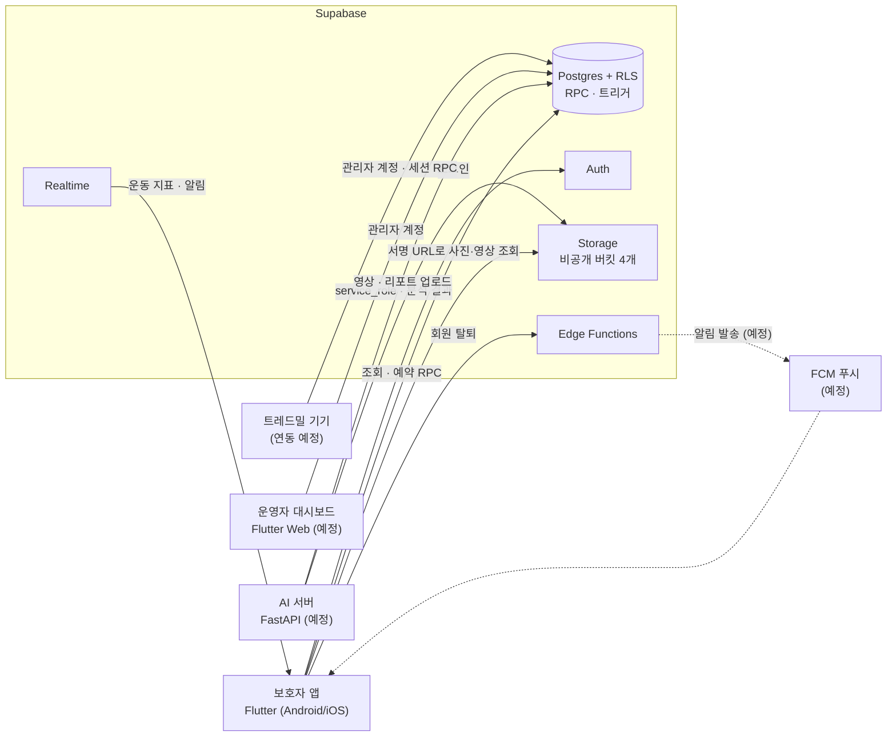

# PawFit 개발계획서

| 항목 | 내용 |
|---|---|
| 문서 버전 | 1.0 |
| 작성일 | 2026-11-11 |
| 기준 코드 | `main` 브랜치 `f06b908` (2026-11-10) |
| 관련 문서 | [기획서](../DOCUMENT.md) · [기능명세서](functional-spec.md) · [AI 분석 결과 저장 규격](analysis-metrics.md) · [랭킹·배지 규격](ranking.md) · [README](../README.md) |

---

## 1. 개요

### 1.1 서비스

PawFit은 반려견 트레드밀 헬스장의 보호자용 모바일 앱이다. 보호자는 앱에서 다음을 한다.

- 반려견 프로필과 건강 정보를 등록한다.
- 트레드밀을 예약하고 이용권을 적용한다.
- 운동 현황을 실시간으로 확인하고 운동 이력을 본다.
- 운동 영상으로 만든 AI 보행 분석 리포트를 받는다.

### 1.2 운영 형태

매장 3곳은 모두 쇼핑몰 안에 있는 **무인 매장**이며, 운영시간은 각 몰의 영업시간을 따른다.

| 지점 | 운영시간 | 트레드밀 |
|---|---|---|
| 용산 아이파크몰점 | 10:30~20:30 (매장 층 미정이라 가장 이른 마감 기준) | 8대 |
| 고양 스타필드점 | 10:00~22:00 | 12대 |
| 영등포 타임스퀘어점 | 10:30~22:00 | 10대 |

매장에 직원이 없으므로 기획서의 "현장 운영자" 역할은 아래처럼 나눈다.

| 업무 | 담당 | 방식 |
|---|---|---|
| 체크인 | 보호자 | 앱의 셀프 체크인 버튼 (예약 시작 15분 전부터 종료 전까지) |
| 운동 시작·정지·비상정지 | 보호자 | 트레드밀 기기에서 직접 조작 |
| 운동 기록 | 트레드밀 기기 | 지점 관리자 계정으로 DB 함수 호출 |
| 문의 응대 | 본사 | 앱 1:1 문의 |
| 결제 | 보호자 | 매장에서 산 이용권 차감 또는 현장 결제. 앱 결제(PG)는 미연동 |

### 1.3 목표

| 구분 | 목표 |
|---|---|
| 단기 | 보호자 앱과 운영 도구를 갖춰 3개 지점 운영을 시작한다 (예약 → 체크인 → 운동 기록). |
| 중기 | 앱 결제, 푸시 알림, AI 보행 분석 리포트를 실제 서비스로 제공한다. |
| 장기 | 개체별 보행 기준선, 이상 탐지, 피로 징후, 운동 프로그램 추천으로 확장한다 (기획서 11장). |

---

## 2. 현재 개발 현황 (2026-11-11 기준)

### 2.1 완료

| 영역 | 내용 |
|---|---|
| 보호자 앱 | 화면 25개. 기획서 10장의 우선 화면 12개와 마이페이지 하위 기능(프로필, 알림 설정, 탈퇴, 반려견 관리, 이용 내역, 공지, FAQ, 1:1 문의, 동의 관리) 포함 |
| 데이터베이스 | 테이블 19개, 모든 테이블에 RLS 적용, 비로그인 접근 차단 |
| 예약 처리 | 서버 함수로만 생성·변경·취소·체크인. 같은 트레드밀·같은 반려견의 시간 중복을 DB 배제 제약으로 차단 |
| 운영 함수 | 체크인, 미방문, 운동 시작·지표 갱신·종료. 담당 지점 권한을 DB에서 검증 |
| 알림 | 예약·운동·분석 상태가 바뀌면 DB 트리거가 앱 알림함에 알림 생성 (Realtime 반영) |
| 파일 저장 | 비공개 버킷 4개 (프로필 사진, 운동 영상, 관절 좌표, 리포트), 경로 기반 접근 권한 |
| 회원 탈퇴 | Edge Function `delete-account`. 파일·계정 삭제, 결제 기록은 보관 |
| 운영 기준 데이터 | 지점 3곳, 운동 프로그램 6개, 트레드밀 30대 (마이그레이션으로 원격에 반영) |
| 디자인 | PawFit 로고 기반 색상, 라이트/다크 모드 |
| 랭킹·배지 (2026-11-16) | 운동 점수 원장(하루 1회·거리 상한·주간 보너스), 월간 랭킹(전체·지점·체급), 내 순위, 닉네임·랭킹 참여 동의·사진 공개 설정, 배지 12종과 배지함, 응원, 지점 대항전, 명예의 전당(pg_cron 월간 마감), 자랑하기 이미지 공유, 매장 랭킹 보드. 규격: [ranking.md](ranking.md) |
| 테스트 | 단위·위젯 78개, pgTAP 143개, 로컬 Supabase 통합 21개 |

### 2.2 부분 구현

| 영역 | 현재 상태 | 남은 일 |
|---|---|---|
| 앱 결제(PG) | 예약 결제 단계와 이용권 구매 시트에 "앱 결제(준비 중)" 자리만 있음 | PG사 선정 후 결제 승인·환불 연동 |
| AI 분석 리포트 | 앱 화면과 결과 저장 규격 완료. 운동 종료 시 분석 대기열 등록까지 동작 | AI 서버 개발. 서버가 없어 리포트가 만들어지지 않음 |
| 맞춤 운동 계획 | 앱에서 조회만 가능 | 계획을 작성할 운영자 도구 |
| 피로 징후 분석 | DB 컬럼만 있음, 앱에 표시하지 않음 | 기획서대로 추후 개발 |

### 2.3 미구현

| 영역 | 설명 |
|---|---|
| 트레드밀 기기 연동 | 기기가 운동 시작·지표·종료를 DB 함수로 보내야 운동 현황과 기록이 쌓인다. 연동 전에는 운동 탭·운동 기록·AI 리포트가 모두 비어 있다. |
| 운영자 대시보드 | 이용권 발급, 예약 관리, 문의 답변, 공지·FAQ 관리 등. 필요한 DB 함수와 권한은 준비됨 |
| AI 서버 | FastAPI 기반 영상 분석. 결과 저장 규격은 [analysis-metrics.md](analysis-metrics.md) |
| FCM 푸시 | Firebase 프로젝트 필요. 지금은 앱 안 알림함으로만 알림 |
| 미방문 자동 처리 | 체크인하지 않은 예약이 시간이 지나도 "예약 확정"으로 남음 |
| 영업시간 예외 | 요일별·명절·휴무일 시간을 지원하지 않음 |
| 비밀번호 찾기 | 로그인 화면에 비밀번호 재설정 기능이 없음 |
| 출시 준비 | 번들 ID(현재 `com.example.dog_treadmill_app`), 스플래시, 약관 전문, 이메일 인증 딥링크 |
| CI | 자동 빌드·테스트 파이프라인 없음 |

---

## 3. 시스템 구성



| 구성 요소 | 역할 | 인증 방식 | 상태 |
|---|---|---|---|
| 보호자 앱 | 예약, 체크인, 운동 현황 조회, 리포트 조회 | 보호자 계정 (이메일) | 개발 완료 |
| Supabase | 데이터, 권한, 업무 규칙(RPC), 알림 생성, 실시간 전달 | - | 개발 완료 |
| 트레드밀 기기 | 운동 시작·지표 갱신·종료 기록 | 지점 관리자 계정 | 미구현 |
| 운영자 대시보드 | 지점 운영, 이용권 발급, 문의 답변, 콘텐츠 관리 | 관리자 계정 | 미구현 |
| AI 서버 | 영상 분석, 지표 산출, 리포트 생성 | `service_role` 키 (서버에만 보관) | 미구현 |
| FCM | 앱 밖 푸시 알림 | Firebase | 미구현 |

---

## 4. 기술 스택 및 개발 환경

| 구분 | 기술 |
|---|---|
| 앱 | Flutter 3.27, Dart 3.6 · Android / iOS (Web은 개발 확인용) |
| 상태 관리 / 라우팅 | flutter_riverpod 2.6 · go_router 16 |
| 앱 라이브러리 | supabase_flutter 2.15, fl_chart, video_player, image_picker, shared_preferences, intl |
| 백엔드 | Supabase — Postgres(RLS), Auth, Storage, Realtime, Edge Functions(Deno) |
| AI (예정) | Python, FastAPI, PyTorch · YOLO Pose, TCN / ST-GCN, XGBoost |
| 운영자 대시보드 (예정) | Flutter Web |
| 푸시 (예정) | Firebase Cloud Messaging |

**개발 환경**

- 로컬: Docker 기반 로컬 Supabase (`npx supabase start`). 마이그레이션과 `seed.sql` 샘플 데이터가 자동 적용된다.
- 원격: Supabase 프로젝트 1개가 운영 겸용이다. 개발용 프로젝트 분리가 필요하다 (Phase 1).
- 앱 설정: 프로젝트 루트 `.env`의 `SUPABASE_URL`, `SUPABASE_PUBLISHABLE_KEY`를 `--dart-define-from-file`로 주입한다.

---

## 5. 개발 로드맵

### 5.1 단계 요약

기간은 착수 주를 W1로 둔 **예상치**이며, 6장의 의사결정이 늦어지면 함께 밀린다.

| 단계 | 목표 | 예상 기간 | 선행 조건 |
|---|---|---|---|
| Phase 1. 출시 준비 | 보호자 앱을 스토어에 올릴 수 있는 상태로 만든다 | W1~W2 | 이용권 가격, 약관 전문 |
| Phase 2. 무인 매장 운영 도구 | 기기 연동과 운영자 대시보드로 매장을 실제로 돌린다 | W3~W8 | 기기 연동 방식, 현장 결제 수단 |
| Phase 3. 결제·푸시 | 앱 결제와 푸시 알림을 붙인다 | W5~W10 (Phase 2와 일부 병행) | PG사 선정, Firebase 프로젝트 |
| Phase 4. AI 분석 서비스 | 운동 영상으로 실제 리포트를 만든다 | W9~W16 | 카메라 설치, 분석 모델 |
| Phase 5. 개인화 건강 관리 | 기준선·이상 탐지·피로 징후·추천 | 데이터 축적 후 (최소 3개월 가정) | 전문가 라벨 데이터, 안전성 검증 |

```
주차        W1  W2  W3  W4  W5  W6  W7  W8  W9  W10 W11 W12 W13 W14 W15 W16
Phase 1     ███████
Phase 2             ███████████████████████
Phase 3                         ███████████████████████
Phase 4                                         ███████████████████████████████
마일스톤        M1                          M2      M3                          M4
```

| 마일스톤 | 시점 | 완료 기준 |
|---|---|---|
| M1 내부 테스트 | W2 | 테스트 계정으로 3개 지점에서 가입 → 반려견 등록 → 예약 → 체크인 → 취소가 원격 환경에서 동작 |
| M2 1차 운영 시작 | W8 | 기기가 운동을 기록하고 앱에 실시간 반영, 매장에서 산 이용권이 대시보드로 발급됨, 미방문 자동 처리 |
| M3 결제·푸시 | W10 | 앱에서 이용권 구매·예약 결제, 예약·운동 푸시 수신 |
| M4 AI 리포트 | W16 | 영상 촬영 동의 회원에게 운동 후 리포트가 자동 도착 |

### 5.2 Phase 1 — 출시 준비 (W1~W2)

| 작업 | 내용 | 비고 |
|---|---|---|
| 운영 데이터 입력 | 이용권 상품·가격, FAQ, 공지 | 원격 DB에 0건 (2026-11-10 확인). `seed.sql`은 샘플이라 원격에 적용되지 않음 |
| 운영자 계정 생성 | 지점별 관리자 계정, 트레드밀 기기용 계정 | `users.role = 'admin'`, `managed_branch_id` |
| 용산점 운영시간 확정 | 매장 층이 정해지면 `branches.closes_at` 수정 | 1~3층·패션파크 4층이면 22:00 마감 |
| 비밀번호 찾기 | 로그인 화면에 재설정 메일 발송, 재설정 화면 | 딥링크 설정과 함께 진행 |
| 이메일 인증 딥링크 | 원격 Auth 이메일 인증을 켜는 경우 모바일 리디렉션 설정 | |
| 약관·개인정보 처리방침 | 회원가입·동의 화면에 전문 연결 (현재 요약 문구만 있음) | |
| 앱 식별 정보 | 번들 ID, 앱 이름, 아이콘, 스플래시 | Android·iOS 모두 |
| 환경 분리 | 개발용 Supabase 프로젝트 추가 | 운영 데이터 오염 방지 |
| CI 구축 | PR마다 `flutter analyze`, `flutter test`, `npx supabase test db` | GitHub Actions |
| 스토어 등록 준비 | 개인정보 처리방침 URL, 스크린샷, 심사용 계정 | |

### 5.3 Phase 2 — 무인 매장 운영 도구 (W3~W8)

**2-1. 트레드밀 기기 연동 (최우선)**

기기 연동이 없으면 운동 현황·운동 기록·AI 리포트가 모두 비어 있으므로 1차 운영 전에 끝내야 한다.

| 작업 | 내용 |
|---|---|
| 연동 방식 확정 | 기기 제조사 API 또는 기기 옆 중계 장치(태블릿 등)에서 Supabase 호출 |
| 현재 예약 찾기 | 기기는 자기 `treadmill_id`에 배정된, 지금 시간대의 체크인 완료 예약을 조회한다 (제안) |
| 운동 시작 | `start_exercise_session(booking_id)` → 보호자 앱에 실시간 반영, 시작 알림 |
| 지표 갱신 | `update_exercise_session_metrics` 주기 호출 (속도, 거리, 경과 시간, 일시정지/재개). 주기는 Realtime 부하를 보고 정한다 |
| 운동 종료 | `finish_exercise_session` — 정상 완료 또는 비상정지(중단 사유 기록) |
| 기기 계정 | 지점 관리자 계정을 기기별로 발급할지, 지점당 하나로 쓸지 결정 |
| 통신 장애 대응 | 네트워크가 끊겼을 때 기기 측 재전송과 종료 누락 처리 |

**2-2. 미방문 자동 처리**

- 예약 종료 시각이 지났는데 체크인하지 않은 예약(예약 대기·확정)을 주기적으로 "미방문"으로 바꾼다 (pg_cron 등).
- 정책 결정 필요: 미방문 시 이용권 차감 유지 여부, 반복 미방문 제한. 현재 `mark_booking_no_show`는 이용권을 복구하지 않는다.

**2-3. 운영자 대시보드 (Flutter Web)**

| 우선순위 | 기능 | 이유 |
|---|---|---|
| 높음 | 이용권 발급·결제 기록 | 앱에 "매장에서 구매하면 바로 보유 이용권에 반영돼요"라고 안내하고 있으나 지금은 SQL로만 발급 가능 |
| 높음 | 지점별 예약 현황, 체크인·미방문 처리, 예약 취소 | 무인 매장 예외 상황 처리 |
| 높음 | 트레드밀 상태 관리 (점검·비활성) | 점검 중인 기기는 예약 배정에서 빠짐 |
| 높음 | 1:1 문의 답변 | 앱의 유일한 고객 응대 창구 |
| 중간 | 공지·FAQ·운동 프로그램·이용권 상품 관리 | |
| 중간 | 운동 세션 모니터링 | 기기 연동 장애 확인 |
| 중간 | 회원·반려견 조회 (건강 정보, 운동 제한 사항) | |
| 낮음 | 맞춤 운동 계획 작성 | 앱의 "맞춤 운동 계획" 섹션 데이터 |
| 낮음 | AI 리포트 검토 (`reviewed_by`) | Phase 4와 함께 |
| 낮음 | 매출·이용 통계 | |

**2-4. 영업시간 예외**

- 요일별 시간, 휴무일, 명절 단축 영업을 지점별로 등록하는 테이블을 추가하고 `get_available_slots`, `assert_bookable_slot`에 반영한다.

### 5.4 Phase 3 — 결제·푸시 (W5~W10)

**3-1. 앱 결제 (PG 연동)**

| 작업 | 내용 |
|---|---|
| PG사 선정 | 카드·간편결제 지원, 수수료, 정산 주기 비교 |
| 결제 승인 검증 | 앱 결제 완료 → Edge Function이 PG 서버에서 승인 확인 → `payments` 기록 (클라이언트 결과를 그대로 믿지 않음) |
| 이용권 구매 | 결제 완료 시 `memberships` 발급 |
| 예약 결제 | 결제 완료 시 예약을 "예약 확정"으로 변경 |
| 환불 | 예약 취소·이용권 환불 정책에 맞춰 부분/전체 환불, `refunded_amount` 기록 |
| 웹훅 | 결제 상태 변경 수신, 중복 처리 방지 (`order_id` 고유) |
| 앱 UI | "앱 결제(준비 중)" 항목을 선택 가능하게 열기 |

**3-2. FCM 푸시**

| 작업 | 내용 |
|---|---|
| Firebase 프로젝트 | Android `google-services.json`, iOS `GoogleService-Info.plist`, APNs 키 |
| 기기 토큰 저장 | 사용자별 FCM 토큰 테이블 (로그인 시 등록, 로그아웃·탈퇴 시 삭제) |
| 발송 | `notifications` 행 생성 → DB 웹훅 → Edge Function → FCM. 알림 설정 필터는 이미 `notify_user`에서 적용됨 |
| 푸시 탭 이동 | 알림함과 같은 규칙 (리포트 → 리포트 화면, 예약 → 예약 상세, 운동 → 운동 탭) |
| 마케팅 동의 정리 | 가입 시 마케팅 동의가 `notification_prefs.marketing`에 반영되지 않는 문제 수정 |
| 리마인더 (제안) | 체크인 시작 시각(예약 15분 전) 알림 |

### 5.5 Phase 4 — AI 분석 서비스 (W9~W16)

| 작업 | 내용 |
|---|---|
| 촬영 환경 | 트레드밀별 정면·측면 카메라 설치, 촬영 시작·종료를 운동 세션과 연결 |
| 영상 업로드 | `exercise-videos/{dog_id}/{session_id}/front.mp4`, `side.mp4` + `pose_records` 기록 |
| AI 서버 | `analysis_status = 'queued'` 작업을 가져가 `processing` → 분석 → `completed` / `failed` |
| 분석 | YOLO Pose 15개 관절 검출 → 관절 각도·가동 범위·보행 주기·대칭성 계산 → 이상 지표 |
| 결과 저장 | `joint_metrics`, `gait_metrics`, `anomaly_metrics`, `summary`, `care_notes` ([저장 규격](analysis-metrics.md)) |
| 산출물 | 스켈레톤 영상, PDF 리포트 업로드 |
| 리포트 검토 | 운영자 대시보드에서 검토 후 공개할지 결정 (검토 절차 필요 여부 결정) |
| 영상 보관 정책 | 원본 영상 보관 기간과 자동 삭제 구현 |
| 학습 데이터 | AI 학습 활용에 동의한 회원 데이터만 비식별화해 학습셋에 넣음 |

### 5.6 Phase 5 — 개인화 건강 관리

기획서 9장 Phase 3 범위다. 반복 운동 데이터가 쌓인 뒤 착수한다.

- 개체별 정상 보행 기준선 구축 (현재 리포트의 `baseline` 값을 실제 데이터로 산출)
- 전문가 라벨 기반 보행 이상 탐지 모델
- 피로 징후 분석 (`fatigue_metrics`) — 전문가 평가 데이터와 안전성 검증을 확보한 뒤
- 웨어러블 심박수 연동
- 운동 프로그램 추천
- 장기 건강 변화 대시보드

---

## 6. 의사결정 필요 사항

| # | 항목 | 현재 상태 | 영향 | 결정 시점 |
|---|---|---|---|---|
| 1 | 무인 매장의 현장 결제 수단 | "현장 결제"를 고르면 예약 대기로 접수되지만, 직원 없는 매장에서 누가 어떻게 결제를 받고 앱에 반영할지 정해지지 않음 | 매출 수납, 이용권 발급 | Phase 2 착수 전 |
| 2 | PG사 | 앱 결제 "준비 중" | Phase 3 일정 | Phase 3 착수 전 |
| 3 | 트레드밀 기기 연동 방식 | 미정 | Phase 2 범위·일정 | Phase 2 착수 전 |
| 4 | 미방문 처리 정책 | 자동 처리 없음, 미방문 시 이용권 복구 안 함 | 이용권 분쟁, 통계 | Phase 2 |
| 5 | 체크인 도착 확인 | 앱 버튼만으로 체크인, 매장 도착 확인 안 함 (QR 대신 선택) | 원격 체크인 악용 가능 | 운영 후 재검토 |
| 6 | 용산점 매장 층 | 미정 → 20:30 마감으로 설정 | 예약 가능 시간 | Phase 1 |
| 7 | 휴무일·요일별 운영시간 | 지원 안 함 | 몰 휴무일 예약 문제 | Phase 2 |
| 8 | 이용권 상품·가격 | 원격 DB에 상품 0건 | 출시 불가 | Phase 1 |
| 9 | 변경·취소 마감, 체크인 오픈 시각 | 시작 1시간 전 / 시작 15분 전 | 이용 약관 문구 | Phase 1 |
| 10 | 약관·개인정보 처리방침 전문 | 요약 문구만 있음 | 스토어 심사, 법적 고지 | Phase 1 |
| 11 | 원본 영상 보관 기간 | 미정 | 개인정보 처리방침, 저장 비용 | Phase 4 착수 전 |
| 12 | AI 리포트 검토 절차 | 검토 없이 완료 즉시 공개 | 리포트 품질 책임 | Phase 4 |
| 13 | 운영자 권한 범위 | 지점 관리자는 예약만 지점 단위, 반려견·운동·이용권·결제는 전 지점 조회 가능 | 개인정보 최소 접근 | Phase 2 |
| 14 | 랭킹 수상 보상 | 배지·칭호·명예의 전당만 (경품 없음) | 이용권 등 경품을 주면 약관에 시상 규정, 대시보드 이용권 발급 필요 | 첫 월간 마감 전 |
| 15 | 랭킹 부정 기록 기준 | 운영자 판단으로 `void_exercise_points` | 원격 체크인·기기 오류 기록이 순위에 섞일 수 있음 | Phase 2 기기 연동 |

---

## 7. 품질 관리

### 7.1 현재 테스트

| 명령 | 대상 | 개수 |
|---|---|---|
| `flutter analyze` | 정적 분석 (strict-casts, strict-raw-types) | - |
| `flutter test` | 단위·위젯 테스트 (오류 문구, 포맷터, 모델, 위젯, 랭킹 모델·화면) | 78 |
| `npx supabase test db` | pgTAP: RLS 격리, 중복 예약 차단, 24시간 지점, 셀프 체크인, 이용권 차감·복구, 운동 세션, 알림 설정, 랭킹 점수 규칙·공개 범위·닉네임·응원·배지·무효 처리·월간 마감 | 143 |
| `flutter test test/integration ...` | 로컬 Supabase 대상: 저장소 계층, Realtime, Storage(랭킹 공개 사진 포함), Edge Function, 랭킹 흐름 | 21 |

### 7.2 계획

- **CI**: PR마다 정적 분석, 단위·위젯 테스트, pgTAP을 자동 실행한다. 통합 테스트는 CI에서 로컬 Supabase를 띄워 실행하는 방안을 검토한다.
- **DB 변경 규칙**: 새 RPC나 정책을 추가하면 pgTAP 테스트를 함께 추가한다 (기존 관례).
- **실기기 테스트**: Android·iOS 실기기에서 라이트/다크 모드, 사진 업로드, 영상 재생, Realtime 재연결을 확인한다.
- **매장 현장 테스트** (Phase 2): 체크인 → 기기에서 운동 시작 → 앱 실시간 반영 → 비상정지/완료 → 기록·알림을 지점마다 확인한다.
- **AI 결과 검증** (Phase 4): 수의사·전문가와 리포트 문구를 검토해 진단 표현이 없는지 확인한다.

---

## 8. 배포·운영

| 대상 | 방법 | 주의 |
|---|---|---|
| DB 마이그레이션 | `npx supabase db push` (수동) | git push만으로는 원격 DB가 바뀌지 않는다. 적용 전 `npx supabase migration list`로 상태 확인. 이미 적용된 마이그레이션은 고치지 않고 새 파일을 추가한다. 랭킹 마이그레이션(`20261116000100`)은 `20261113000100`(반려견 체구) 다음에 적용되어야 하고, pg_cron 확장과 매일 마감 작업을 함께 등록한다 |
| Edge Function | `npx supabase functions deploy <name>` | 현재 `delete-account` |
| 운영 데이터 | 대시보드 또는 SQL | `seed.sql`은 로컬 전용 |
| 앱 | Google Play, App Store | 현재 버전 `1.0.0+1` |
| 비밀값 | `.env`는 커밋 금지. `service_role` 키는 AI 서버·Edge Function에만 둔다 | 앱에는 publishable 키만 |

**배포 체크리스트**

1. 새 마이그레이션을 로컬에서 `npx supabase db reset`과 `npx supabase test db`로 확인한다.
2. 원격 `migration list`로 적용 상태를 확인하고 `db push`를 실행한다.
3. 변경된 Edge Function을 배포한다.
4. 앱 빌드에 들어간 DB 함수·컬럼이 원격에 있는지 확인한 뒤 앱을 배포한다.

---

## 9. 리스크 및 대응

| 리스크 | 영향 | 대응 |
|---|---|---|
| 트레드밀 기기 연동 지연 | 운동 현황·기록·AI 리포트가 비어 앱의 핵심 가치가 없음 | Phase 2 최우선. 연동 전에 출시하면 운동 탭 안내 문구를 조정 |
| AI 서버 없이 분석 대기열이 쌓임 | 영상 촬영 동의 회원의 앱에 "분석 중"이 계속 표시됨 | AI 서버 가동 전까지 대기열 등록을 보류하거나 "준비 중" 안내로 바꿈 |
| 결제 수단 공백 | 현장 결제 수단 미정 + PG 미연동으로 매출을 받을 방법이 없음 | 의사결정 #1, #2를 가장 먼저 처리 |
| 무인 매장 안전사고 | 보호자 조작 중 반려견 부상 | 앱·기기·매장 안내물로 보호자 책임과 비상정지 위치 안내, 약관에 책임 범위 명시, 운동 제한 사항 경고(구현됨) |
| 원격 체크인 악용 | 매장에 없는데 체크인 | 기기 운동 시작 기록으로 사후 확인, 필요하면 QR·NFC 도입 |
| 미방문으로 슬롯 낭비 | 다른 회원이 예약하지 못함 | 미방문 자동 처리와 제한 정책 |
| 원격 마이그레이션 적용 누락 | 앱과 DB 불일치로 기능 오류 | 배포 체크리스트, CI에서 스키마 차이 검사 |
| AI 결과를 진단으로 오해 | 법적·신뢰 문제 | 모든 리포트 화면에 고지 문구(구현됨), 저장 규격에서 진단 표현 금지 |
| 개인정보·영상 유출 | 법적 책임 | 비공개 버킷, RLS, 1시간 서명 URL, 동의 분리(구현됨). 영상 보관 기한 정책 수립 |
| 운영·개발 DB 공용 | 테스트 데이터가 운영에 섞임 | Phase 1에서 개발 프로젝트 분리 |
| 랭킹이 무리한 운동을 부추김 | 무인 매장에서 반려견 부상 | 반려견당 하루 1회만 점수, 거리 점수 상한(2km), 중단 감점 없음, 속도 순위 없음, "많이보다 꾸준히" 안내(구현됨) |
| 랭킹으로 개인정보 노출 | 다른 회원에게 신원이 드러남 | 동의한 회원만, 닉네임으로 노출, 실명·이메일·연락처 미반환, 사진은 별도 공개 설정, 철회 즉시 가림(구현됨) |
