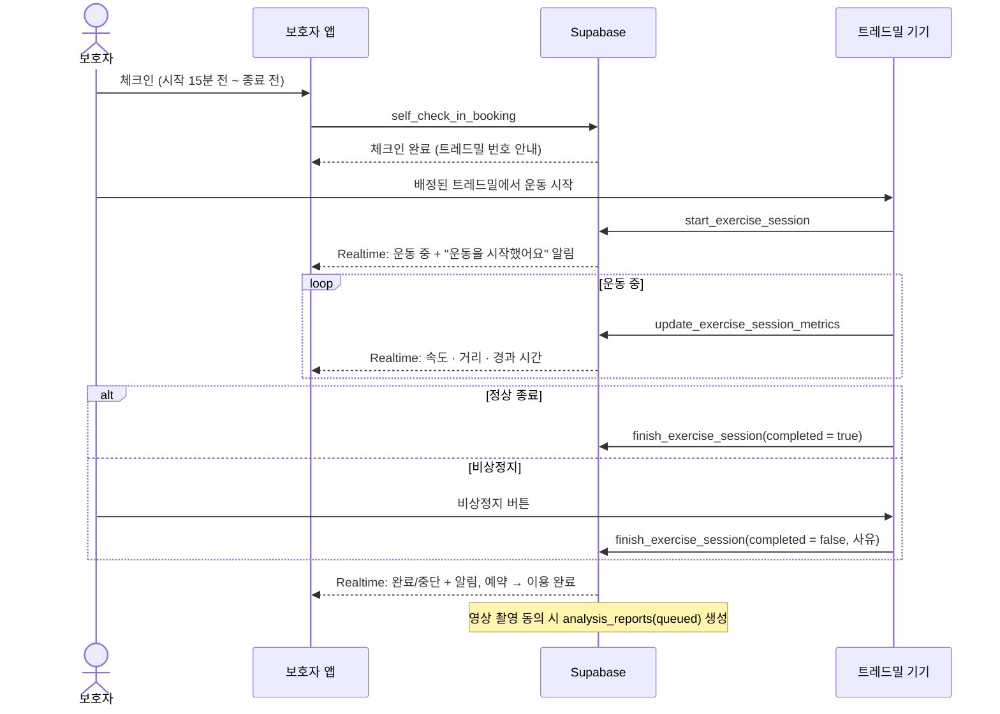
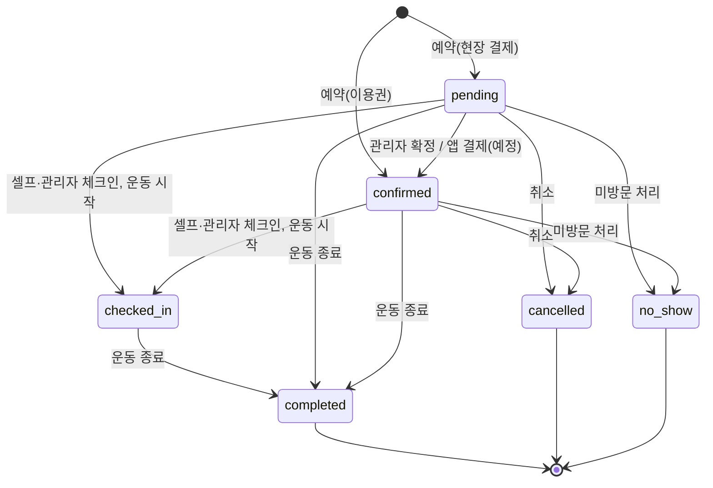

# PawFit 기능명세서

| 항목 | 내용 |
|---|---|
| 문서 버전 | 1.1 |
| 작성일 | 2026-11-11 (1.1: 2026-11-16 랭킹·배지 추가) |
| 기준 코드 | `main` 브랜치 `f06b908` (2026-11-10) + 랭킹·배지 (마이그레이션 `20261116000100`) |
| 관련 문서 | [기획서](../DOCUMENT.md) · [개발계획서](development-plan.md) · [AI 분석 결과 저장 규격](analysis-metrics.md) · [랭킹·배지 규격](ranking.md) |

---

## 1. 개요

### 1.1 목적과 범위

이 문서는 PawFit 보호자 앱의 화면과 기능, 그리고 이를 처리하는 서버(Supabase) 규칙을 정의한다.
운영자 대시보드·트레드밀 기기·AI 서버는 아직 없으므로 앱·DB와 주고받는 인터페이스만 다룬다.

각 기능의 상태는 아래처럼 표시한다.

| 표시 | 의미 |
|---|---|
| 구현 | 현재 코드에 동작하는 기능이 있음 |
| 부분 | 화면이나 DB만 있고 실제 동작은 일부만 됨 |
| 예정 | 아직 없음. [개발계획서](development-plan.md)에 일정이 있음 |

### 1.2 용어

| 용어 | 뜻 |
|---|---|
| 보호자 | 앱 회원. 반려견을 등록하고 예약하는 사람 |
| 지점 | 트레드밀 매장. 현재 3곳, 모두 쇼핑몰 안 무인 매장 |
| 운동 프로그램 | 예약할 때 고르는 운동 종류. 운동 시간(=예약 길이)과 강도를 가짐 |
| 슬롯 | 예약을 시작할 수 있는 시각. 지점 운영 시작부터 30분 간격 |
| 이용권 | 횟수제 상품. 예약 1건에 1회 차감 |
| 현장 결제 | 이용권 없이 예약하고 이용 당일 매장에서 결제하는 방식. 예약은 "예약 대기"로 접수됨 |
| 셀프 체크인 | 보호자가 앱 버튼으로 하는 체크인. 매장 도착 여부는 확인하지 않음 |
| 운동 세션 | 트레드밀 1회 운동 기록. 기기가 시작·갱신·종료함 |
| 분석 리포트 | 운동 영상으로 만든 AI 보행 분석 결과 |
| 기준선 | 반려견별 평소(정상) 보행 지표. 리포트에서 비교 기준으로 씀 |
| 지점 관리자 | 특정 지점을 담당하는 관리자 계정. 트레드밀 기기도 이 계정으로 동작 |
| 랭킹 점수 | 운동이 끝나면 쌓이는 점수. 출석·달성·거리·주간 보너스 ([ranking.md](ranking.md)) |
| 랭킹 참여 | 닉네임·반려견 정보를 다른 회원에게 공개하는 선택 동의. 참여한 회원의 반려견만 순위표에 나옴 |
| 닉네임 | 랭킹·응원에 보이는 이름. 가입 시 자동 생성, 30일에 한 번 변경 |
| 명예의 전당 | 달마다 마감한 부문별 1~3위 기록 |

---

## 2. 사용자와 권한

| 역할 | 식별 방법 | 할 수 있는 일 |
|---|---|---|
| 비로그인 | - | 로그인·회원가입 화면만. DB의 어떤 테이블에도 접근할 수 없음 |
| 보호자 | `users.role = 'user'` | 본인 정보·반려견·예약·운동·분석·이용권·결제·알림·문의 조회와 관리 |
| 지점 관리자 | `role = 'admin'`, `managed_branch_id = 지점` | 담당 지점의 예약 관리, 운동 세션 기록, 트레드밀 관리 |
| 전체 관리자 | `role = 'admin'`, `managed_branch_id = NULL` | 전 지점 관리, 카탈로그(프로그램·이용권 상품·공지·FAQ) 관리 |
| 트레드밀 기기 | 지점 관리자 계정 | 운동 세션 시작·지표 갱신·종료 (예정) |
| AI 서버 | `service_role` 키 | RLS를 우회해 분석 결과와 파일 저장 (예정) |

권한별 상세는 [9장 권한 매트릭스](#9-권한-매트릭스)를 따른다.

---

## 3. 화면 구성

### 3.1 내비게이션 규칙

- 로그인하지 않았으면 어느 경로로 들어와도 로그인 화면으로 보낸다.
- 로그인한 상태에서 로그인·회원가입 화면에 들어오면 홈으로 보낸다.
- 로그인·로그아웃이 일어나면 라우터가 즉시 다시 판단한다.
- 하단 탭은 5개이며 탭마다 화면 이동 기록을 따로 유지한다. 지금 탭을 다시 누르면 그 탭의 첫 화면으로 돌아간다.
- `.env` 설정 없이 실행하면 "Supabase 설정이 필요해요" 안내 화면만 보여 준다.

### 3.2 화면 목록

| ID | 화면 | 경로 | 진입 위치 |
|---|---|---|---|
| SCR-01 | 로그인 | `/login` | 앱 시작 (비로그인) |
| SCR-02 | 회원가입 | `/signup` | 로그인 화면 |
| SCR-03 | 홈 | `/home` | 하단 탭 1 |
| SCR-04 | 예약 내역 | `/booking` | 하단 탭 2 |
| SCR-05 | 운동 | `/exercise` | 하단 탭 3 |
| SCR-06 | 건강 | `/health` | 하단 탭 4 |
| SCR-07 | 마이페이지 | `/my` | 하단 탭 5 |
| SCR-08 | 알림 | `/notifications` | 홈 상단 알림 아이콘 |
| SCR-09 | 운동 예약 | `/bookings/new` | 홈, 예약 탭, 운동 탭, 반려견 상세 |
| SCR-10 | 예약 상세 | `/bookings/:id` | 예약 목록, 홈, 알림 |
| SCR-11 | 운동 기록 | `/exercise-history` | 홈, 운동 탭, 마이페이지, 예약 상세(이용 완료) |
| SCR-12 | AI 분석 리포트 | `/reports/:id` | 건강 탭, 운동 기록, 알림 |
| SCR-13 | 영상 재생 | `/video?path=&title=` | AI 분석 리포트 |
| SCR-14 | 반려견 관리 | `/dogs` | 마이페이지 |
| SCR-15 | 반려견 등록 | `/dogs/new` | 홈, 마이페이지, 반려견 관리, 반려견 전환 시트, 반려견이 없을 때의 안내 |
| SCR-16 | 반려견 상세 | `/dogs/:id` | 홈, 반려견 관리 |
| SCR-17 | 반려견 정보 수정 | `/dogs/:id/edit` | 반려견 상세 |
| SCR-18 | 반려견 전환 | 바텀시트 | 홈 "전환" 버튼 |
| SCR-19 | 이용권 | `/membership` | 마이페이지 |
| SCR-20 | 결제·환불 내역 | `/payments` | 예약 탭, 이용권, 마이페이지 |
| SCR-21 | 프로필 및 로그인 계정 | `/settings/profile` | 마이페이지 |
| SCR-22 | 알림 설정 | `/settings/notifications` | 마이페이지 |
| SCR-23 | 개인정보 및 영상 이용 동의 | `/settings/consents` | 마이페이지, 알림 설정, 홈·건강 탭 동의 안내 |
| SCR-24 | 공지사항 | `/notices` | 홈, 마이페이지 |
| SCR-25 | 자주 묻는 질문 | `/faq` | 마이페이지 |
| SCR-26 | 1:1 문의 내역 | `/inquiries` | 마이페이지 |
| SCR-27 | 1:1 문의 작성 | `/inquiries/new` | 1:1 문의 내역, FAQ, 예약 상세 |
| SCR-28 | 랭킹 (반려견 랭킹 / 지점 대항전 / 명예의 전당) | `/ranking?tab=battle\|hall` | 홈, 마이페이지, 랭킹 알림 |
| SCR-29 | 배지함 | `/dogs/:id/badges` | 반려견 상세, 배지 알림 |
| SCR-30 | 매장 랭킹 보드 | `/board/:branchId` | 랭킹 메뉴 (관리자), 매장 태블릿·TV |
| SCR-31 | 랭킹 참여·닉네임 설정 | 바텀시트 | 랭킹 메뉴·참여 안내, 홈 랭킹 섹션, 마이페이지 |
| SCR-32 | 반려견 랭킹 프로필 | 바텀시트 | 순위표·시상대·명예의 전당의 반려견, 내 순위 바 |
| SCR-33 | 이번 달 기록 자랑하기 | 바텀시트 | 랭킹 화면 공유 아이콘 |
| SCR-34 | 점수 규칙 · 운동 점수 내역 | 바텀시트 | 랭킹 메뉴 · 운동 기록의 점수 칩 |

### 3.3 공통 규칙

- **선택된 반려견**: 홈에서 고른 반려견이 홈·예약·운동·건강 탭의 기준이 된다. 선택은 기기에 저장되어 앱을 다시 열어도 유지된다. 저장된 반려견이 없거나 삭제되었으면 첫 번째 반려견을 쓴다.
- **반려견이 없을 때**: 운동·건강 탭과 운동 기록은 "등록된 반려견이 없어요" 안내와 등록 버튼을 보여 준다.
- **목록 상태**: 모든 목록은 로딩 / 오류(다시 시도 버튼) / 빈 상태 안내를 갖는다.
- **AI 고지**: AI 결과가 나오는 화면에는 "AI 분석 결과는 보행 변화에 대한 참고 정보이며, 질병 진단이나 수의사의 진료를 대체하지 않습니다." 문구를 둔다.
- **오류 문구**: 서버 오류 코드는 한국어 안내로 바꿔 보여 준다 ([7장](#7-오류-메시지)).

---

## 4. 기능 상세

### 4.1 인증·회원 (AUTH)

| ID | 기능 | 상세 | 상태 |
|---|---|---|---|
| AUTH-01 | 로그인 | 이메일·비밀번호로 로그인. 비밀번호 보기/숨기기. 성공하면 홈으로 이동 | 구현 |
| AUTH-02 | 회원가입 | 보호자 정보·로그인 정보·동의를 받아 가입 (아래 규칙) | 구현 |
| AUTH-03 | 이메일 인증 안내 | 원격 Auth에서 이메일 인증을 켠 경우 "인증 메일을 보냈어요" 안내 후 로그인 화면으로 돌아감 | 구현 |
| AUTH-04 | 로그아웃 | 확인 다이얼로그 후 로그아웃 | 구현 |
| AUTH-05 | 회원 탈퇴 | 확인 다이얼로그 후 Edge Function `delete-account` 호출 (아래 규칙) | 구현 |
| AUTH-06 | 프로필 수정 | 이름, 휴대전화 번호 수정 | 구현 |
| AUTH-07 | 비밀번호 변경 | 새 비밀번호와 확인 입력 | 구현 |
| AUTH-08 | 비밀번호 찾기 | 재설정 메일 발송, 재설정 화면 | 예정 |

**회원가입 입력 검증**

| 항목 | 규칙 | 오류 문구 |
|---|---|---|
| 이름 | 필수, 20자 이내 | 이름을 입력해 주세요. / 20자 이내로 입력해 주세요. |
| 휴대전화 번호 | 01(0·1·6·7·8·9)로 시작하는 10~11자리. 하이픈은 자동 정리 | 올바른 휴대전화 번호가 아니에요. |
| 이메일 | 이메일 형식 | 올바른 이메일 형식이 아니에요. |
| 비밀번호 | 8자 이상, 영문과 숫자 포함 | 8자 이상 입력해 주세요. / 영문과 숫자를 함께 사용해 주세요. |
| 비밀번호 확인 | 비밀번호와 같아야 함 | 비밀번호가 일치하지 않아요. |
| 동의 | 필수 2개(이용약관, 개인정보 수집·이용)에 동의해야 가입 가능. "전체 동의"로 한 번에 선택 | 필수 약관에 동의해 주세요. |

**회원가입 처리**

1. 앱이 Supabase Auth에 가입을 요청하며 이름·연락처·동의 목록을 메타데이터로 보낸다.
2. DB 트리거 `handle_new_user`가 `users` 프로필과 동의 이력 5건(`data_consents`, 버전 1.0)을 만든다. 이름이 비어 있으면 이메일 앞부분을 쓴다.
3. 바로 로그인되면 홈으로, 이메일 인증이 필요하면 안내 다이얼로그를 띄운다.

**회원 탈퇴 처리**

- 안내 문구: 반려견 정보, 예약, 운동·분석 기록, 남은 이용권이 모두 삭제되며 복구할 수 없음. 결제 기록은 법령에 따라 보관.
- 서버 처리 순서: 본인 확인(토큰) → Storage 파일 삭제(`dog-profiles/{user_id}`, 반려견별 `exercise-videos`·`pose-data`·`analysis-reports`) → Auth 계정 삭제 → `users` 이하 데이터 연쇄 삭제.
- 결제 기록(`payments`)은 `user_id`만 비우고 남긴다.
- 탈퇴 후 앱은 로컬 세션만 정리하고 로그인 화면으로 이동한다.

### 4.2 홈 (HOME)

| ID | 기능 | 상세 | 상태 |
|---|---|---|---|
| HOME-01 | 반려견 카드 | 선택된 반려견의 사진·이름·요약(견종·나이·체중), 인사 문구. 랭킹 참여 중이면 "이번 달 전체 n위" 칩. 이번 달 운동 횟수, 이번 달 거리(km), 최근 좌우 대칭(%) | 구현 |
| HOME-02 | 프로필 완성 안내 | 견종·생년월일·체중이 모두 비어 있으면 요약 대신 "프로필을 완성해 주세요" 표시 | 구현 |
| HOME-03 | 반려견 전환 | 반려견이 2마리 이상이면 "전환" 버튼 → 반려견 전환 시트 | 구현 |
| HOME-04 | 반려견 등록 유도 | 반려견이 없으면 등록 안내 카드와 "반려견 등록하기" 버튼 | 구현 |
| HOME-05 | 진행 중 운동 | 운동 중인 세션이 있으면 "실시간 운동 현황 보기" 카드 → 운동 탭 | 구현 |
| HOME-06 | 빠른 메뉴 | 운동 예약(빈 시간 확인), AI 리포트(보행 분석), 운동 기록(전체 이력) | 구현 |
| HOME-07 | 다음 예약 | 가장 가까운 진행 예정 예약. 체크인 가능 시간이면 체크인 버튼 표시. 없으면 "예약하기" | 구현 |
| HOME-08 | 최근 운동 | 최근 운동 기록 요약, "전체 기록" 링크 | 구현 |
| HOME-09 | AI 보행 분석 요약 | 최근 리포트의 좌우 대칭성·분당 걸음 수·이상 수준. 리포트가 없으면 상황별 안내 (아래) | 구현 |
| HOME-10 | 공지사항 | 최근 공지, "전체보기" | 구현 |
| HOME-11 | 알림 아이콘 | 읽지 않은 알림 수 배지 (99개 초과 시 99+) | 구현 |
| HOME-12 | 이번 달 랭킹 | "다음 예약" 아래. 내 반려견 전체 순위·점수·다음 순위까지 남은 점수, 지점·체급 순위와 연속 운동 칩, 전체 1~3위. 점수가 없으면 "이번 달 첫 운동을 기다리고 있어요", 미참여면 "참여하면 전체 n위예요"와 "랭킹 참여하기" 버튼 | 구현 |

**AI 보행 분석 안내 (리포트가 없을 때)**

| 상황 | 문구 | 버튼 |
|---|---|---|
| 분석 중인 영상이 있음 | 최근 운동 영상을 분석하고 있어요. 완료되면 알려 드릴게요. | - |
| 영상 촬영 미동의 | 운동 영상 촬영에 동의하면 AI 보행 분석 리포트를 받을 수 있어요. | 동의하기 |
| 동의했으나 운동 기록 없음 | 운동을 마치면 AI 보행 분석 리포트가 여기에 표시돼요. | - |

### 4.3 반려견 (DOG)

| ID | 기능 | 상세 | 상태 |
|---|---|---|---|
| DOG-01 | 반려견 등록 | 기본 정보·사진·건강 정보 입력 (아래 표) | 구현 |
| DOG-02 | 반려견 정보 수정 | 등록 화면과 같은 양식, 기존 값 채움 | 구현 |
| DOG-03 | 반려견 상세 | 기본 정보, 누적 운동(횟수·시간·거리), 건강 정보, 맞춤 운동 계획, "{이름} 운동 예약하기" 버튼 | 구현 |
| DOG-04 | 반려견 삭제 | 확인 후 소프트 삭제. 목록에서 사라지고 새 예약 불가. 운동·분석 기록은 보존 | 구현 |
| DOG-05 | 반려견 관리 목록 | 등록된 반려견 목록, 홈에 표시 중인 반려견 표시, 등록 버튼 | 구현 |
| DOG-06 | 반려견 전환 | 바텀시트에서 선택, 기기에 저장. "반려견 추가" 진입 | 구현 |
| DOG-07 | 프로필 사진 | 앨범 선택 또는 촬영 → 비공개 버킷 업로드 → 이전 사진 삭제. 표시할 때 1시간짜리 서명 URL 사용 | 구현 |
| DOG-08 | 배지 | 반려견 상세에 받은 배지 수(n/12), 수상 칭호, 받은 배지, 다음 배지 진행률. "배지함"에서 전체 배지·진행률·획득일 (RNK-07) | 구현 |

**입력 항목**

| 구분 | 항목 | 규칙 |
|---|---|---|
| 기본 | 사진 | 앨범/촬영. 최대 폭 1024px, 품질 85%로 줄여 올림. 5MB 이하, JPEG·PNG·WebP·HEIC |
| 기본 | 이름 | 필수, 30자 이내 |
| 기본 | 믹스견 여부 | "믹스견이에요" 스위치 (두 견종 이상이 섞였거나 견종을 모를 때) |
| 기본 | 견종 | 필수(믹스견이면 "섞인 견종" 선택 입력), 50자 이내. 견종 카탈로그(`breeds`, 40종) 자동완성. 카탈로그 견종을 고르면 체구·단두종이 자동으로 정해진다 |
| 기본 | 체구 | 카탈로그 밖 견종·믹스견이면 필수: 소형(10kg 미만) / 중형(10~25kg) / 대형(25kg 이상), 다 자란 몸무게 기준 |
| 기본 | 단두종 | 카탈로그 밖 견종·믹스견이면 "주둥이가 짧은 단두종이에요" 스위치 |
| 기본 | 나이 | 필수. "생년월일" 선택 또는 "추정 나이"(살 0~30 + 개월 0~11, 1개월 이상). 추정 나이는 그달 1일생으로 저장하고 추정 표시를 남긴다 |
| 기본 | 성별 | 선택. 수컷 / 암컷 |
| 기본 | 중성화 | 필수. 했어요 / 안 했어요 |
| 기본 | 체중 | 필수, 0 초과 150 미만 (kg). 바뀔 때마다 체중 기록(`dog_weight_logs`)에 쌓인다 |
| 건강 | 질병·주의사항 | 필수. 카탈로그(`health_conditions`) 다중 선택 또는 "해당 없음": 관절질환, 척추·디스크 질환, 심장질환, 비만, 호흡기질환, 내분비질환, 신장질환, 뇌전증·발작, 발바닥·피부 질환, 수술·부상 회복 중 |
| 건강 | 질환 상세 | 항목 목록: 진단명(50자) + 상태·단계(100자, 선택) + 날짜(선택) |
| 건강 | 수술 및 치료 이력 | 항목 목록: 수술·치료명 + 병원·메모 + 날짜 |
| 건강 | 복용 중인 약물 | 항목 목록: 약 이름 + 용량·복용 주기 + 날짜 |
| 건강 | 운동 제한 사항 | 항목 목록: 제한 내용(예: 경사 운동 금지) + 상세 설명 + 날짜 |
| 건강 | 수의사 권고사항 | 자유 입력, 2000자 이내 |

- 사진 업로드만 실패하면 "정보는 저장했지만 사진을 올리지 못했어요." 안내 후 나머지 정보는 저장한다.
- 운동 제한 사항은 예약 화면에서 경고로 다시 보여 준다 (BKG-02).
- 필수 항목(*)은 AI 운동 강도 산정·금기 규칙의 입력이다. 기존 반려견은 수정 화면에서 빈 항목을 채워야 저장된다.
- 과거 운동 이력은 입력받지 않는다. 트레드밀이 남긴 운동 세션을 AI 서버가 읽어 간다 (AI-02). 상세 화면에도 보여 주지 않는다.

### 4.4 예약 (BKG)

| ID | 기능 | 상세 | 상태 |
|---|---|---|---|
| BKG-01 | 예약 내역 | 예약 탭. "예정된 예약 / 지난 예약" 탭, 사용 가능한 이용권 잔여 횟수 요약, "새 운동 예약" 버튼, 결제·환불 내역 진입 | 구현 |
| BKG-02 | 운동 예약 | 반려견 → 지점 → 프로그램 → 날짜 → 시간 → 결제 → 메모 순서로 선택 후 예약 (아래 흐름) | 구현 |
| BKG-03 | 예약 상세 | 진행 단계, 예약 정보, 상태별 안내, 체크인·취소·시간 변경·문의 버튼 | 구현 |
| BKG-04 | 셀프 체크인 | 예약 상세와 홈에서 체크인 | 구현 |
| BKG-05 | 예약 취소 | 사유 선택 후 취소, 이용권 회차 복구 | 구현 |
| BKG-06 | 예약 시간 변경 | 같은 지점·프로그램으로 시간만 변경 | 구현 |
| BKG-07 | 앱 결제 | 결제 단계의 "앱 결제" 항목. "준비 중"으로 선택 불가 | 부분 |
| BKG-08 | 미방문 자동 처리 | 체크인하지 않고 끝난 예약을 미방문 처리 | 예정 |

**BKG-02 운동 예약 흐름**

| 단계 | 내용 |
|---|---|
| 반려견 | 등록된 반려견 중 선택 (기본값: 선택된 반려견). 없으면 "예약하려면 먼저 반려견을 등록해 주세요." |
| 운동 제한 경고 | 반려견에게 운동 제한 사항이 있으면 "운동 제한 사항: …" 경고. 무인 매장이라 보호자가 직접 확인해야 한다는 안내 |
| 지점 | 활성 지점 목록과 운영시간 (기본값: 첫 지점) |
| 운동 프로그램 | 이름, 운동 시간, 강도(저/중/고강도), 설명 |
| 날짜 | 오늘부터 14일 |
| 시간 | 새벽·오전·오후·저녁으로 묶은 슬롯. 슬롯마다 "잔여 N대" 또는 "마감" |
| 결제 | 이 시간에 쓸 수 있는 보유 이용권 / 현장 결제 / 앱 결제(준비 중, 선택 불가) |
| 메모 | 선택, 500자 이내 (예: 낯선 소리에 예민해요) |
| 안내 | 무인 매장 체크인 방법, 변경·취소 마감, 이용권 복구 규칙 |
| 요약·확정 | "반려견 · 날짜 시간 · 프로그램 · 결제 방법" 요약 후 "예약하기" |

- 이용권 자동 선택: 보호자가 직접 고르지 않으면 선택한 시간에 쓸 수 있는 이용권 중 만료일이 가장 빠른 것을 적용한다.
- 결과: 이용권 적용 → "예약 확정" / 현장 결제 → "예약 대기"("이용 당일 매장에서 결제해 주세요.").
- 예약 직후 예약 상세 화면으로 이동한다.
- "트레드밀이 모두 예약됨"이나 "지난 시간" 오류가 나면 시간 목록을 새로고침하고 선택을 해제한다.

**예약 가능 시간 계산 (`get_available_slots`)**

- 슬롯은 운영 시작 시각부터 `slot_minutes`(기본 30분) 간격으로 만든다.
- 마지막 슬롯은 "마감 시각 − 프로그램 시간"이다. 운동은 영업시간 안에 끝나야 한다.
- 24시간 지점(`opens_at 00:00`, `closes_at 24:00`)은 하루의 모든 슬롯을 열고 자정을 넘기는 예약을 허용한다. 현재 해당 지점은 없다.
- 잔여 수 = 그 시간에 겹치는 활성 예약(예약 대기·확정·체크인)이 없는 트레드밀 수. 점검·비활성 기기는 제외한다.
- 이미 지난 슬롯은 보여 주지 않는다.
- 다른 회원의 예약 정보는 내려 주지 않고 개수만 준다.

**예약 생성 서버 검증 (`create_booking`)**

1. 로그인 사용자, 본인 소유이며 삭제되지 않은 반려견, 활성 지점, 활성 프로그램인지 확인한다.
2. 시작 시각이 미래이고, 슬롯 간격에 맞고, 영업시간 안에 끝나는지 확인한다.
3. 같은 반려견이 그 시간에 다른 활성 예약을 갖고 있으면 거절한다.
4. 이용권을 쓰면: 본인 이용권, 사용 가능 상태, 잔여 1회 이상, 유효기간이 예약 시간을 모두 포함해야 한다.
5. 빈 트레드밀을 기기 이름순(T-01, T-02…)으로 찾아 배정한다. 동시에 같은 기기를 잡으면 DB 배제 제약이 막고 다음 기기를 시도한다.
6. 이용권을 썼으면 잔여 횟수를 1 줄인다.

**BKG-03 예약 상세**

| 영역 | 내용 |
|---|---|
| 진행 단계 | 접수 → 확정 → 체크인 → 이용 완료. 취소·미방문은 별도 문구 ("취소된 예약이에요." / "방문하지 않아 미방문 처리된 예약이에요.") |
| 예약 정보 | 반려견, 지점, 트레드밀, 프로그램(이름·시간·강도), 결제(이용권 1회 사용 / 현장 결제), 메모, 취소 사유 |
| 상태별 안내 | 체크인 가능 시각, 변경·취소 마감, 현장 결제 안내, 체크인 후 "트레드밀 T-0N에서 운동을 시작하고 곁을 지켜 주세요" |
| 버튼 (예약 대기·확정) | 체크인(가능 시간에만), 예약 취소·시간 변경(시작 1시간 전까지). 둘 다 할 수 없으면 "1:1 문의하기" |
| 버튼 (체크인 완료) | 없음. 트레드밀에서 운동을 시작하라는 안내만 표시 |
| 버튼 (이용 완료) | "운동 기록 보기" → 운동 기록 |
| 버튼 (취소·미방문) | 없음 |

**BKG-04 셀프 체크인 (`self_check_in_booking`)**

| 조건 | 값 |
|---|---|
| 대상 | 본인 예약 |
| 예약 상태 | 예약 대기 또는 예약 확정 (현장 결제 예약도 가능) |
| 가능 시간 | 예약 시작 15분 전부터 예약 종료 전까지 |
| 도착 확인 | 하지 않음 |
| 결과 | 예약 상태 → 체크인 완료. "체크인했어요. 트레드밀 T-0N에서 운동을 시작해 주세요." |

**BKG-05 예약 취소 (`cancel_booking`)**

- 사유 선택: 일정이 변경되었어요 / 반려견 컨디션이 좋지 않아요 / 다른 시간으로 다시 예약할게요 / 기타.
- 예약 대기·확정 상태에서만, 예약 시작 1시간 전까지 가능하다. 관리자는 마감 제한이 없다.
- 이용권으로 예약했으면 1회를 복구한다 (총 횟수를 넘지 않음).

**BKG-06 시간 변경 (`reschedule_booking`)**

- 같은 지점·같은 프로그램에서 날짜와 시간만 다시 고른다.
- 취소와 같은 마감(시작 1시간 전)을 적용한다.
- 이용권 예약이면 새 시간이 이용권 유효기간 안이어야 한다.
- 트레드밀은 기존 기기를 먼저 시도하고, 비어 있지 않으면 다른 빈 기기로 다시 배정한다.

### 4.5 운동 (EXR)

운동 화면은 조회 전용이다. 트레드밀 조작은 보호자가 기기에서 하고, 기기가 기록을 보낸다 (4.11).

| ID | 기능 | 상세 | 상태 |
|---|---|---|---|
| EXR-01 | 실시간 운동 현황 | 선택된 반려견의 최신 세션을 Realtime으로 구독. 영상은 받지 않고 지표만 받음 | 구현 |
| EXR-02 | 운동 종료 알림 | 진행 중이던 운동이 끝나면 "운동을 완료했어요!" 또는 "운동이 중단되었어요." 표시, 기록·리포트 목록 갱신 | 구현 |
| EXR-03 | 진행 중 운동 없음 | "진행 중인 운동이 없어요" 안내, "운동 예약하기", 다음 예약 | 구현 |
| EXR-04 | 이번 달 요약 | 운동 횟수, 총 운동 시간(분), 총 거리 | 구현 |
| EXR-05 | 최근 운동 기록 | 최근 기록 목록, "전체 기록" 링크 | 구현 |
| EXR-06 | 운동 기록 (전체) | 누적 통계 + 월별 기록 목록 | 구현 |
| EXR-07 | 기기 연동 | 기기가 세션을 기록해야 위 화면에 데이터가 생김 | 예정 |
| EXR-08 | 랭킹 점수 | 운동 기록마다 받은 점수 칩("+40점", 0점이면 이유: 5분 미만 / 하루 1회). 누르면 출석·달성·거리·주간 보너스 내역. 월별 머리글에 그달 점수 합계 | 구현 |

**EXR-01 실시간 운동 현황 표시 항목**

| 항목 | 내용 |
|---|---|
| 상태 | 운동 중 / 일시정지 |
| 경과 시간 | 1초마다 갱신. 운동 중이면 마지막 서버 갱신 이후 시간을 더해 자연스럽게 증가 |
| 진행률 | 목표 시간(프로그램 시간) 대비 진행률 링 |
| 현재 속도 | km/h |
| 이동 거리 | m / km |
| 시작 시간, 트레드밀 | 예: T-03 |
| 안전 안내 | "무인 매장이에요. 운동하는 동안 반려견 곁을 지켜 주시고, 이상하면 트레드밀의 비상정지 버튼을 눌러 주세요." |

**EXR-06 운동 기록**

- 누적: 총 운동 횟수, 총 시간, 총 거리, 최고 속도.
- 월별로 묶어 최신순 표시 ("2026년 11월 · 3회").
- 기록 1건: 날짜, 트레드밀, 운동 시간, 이동 거리, 평균/최고 속도, 중단 사유(중단된 경우), AI 리포트 상태(리포트 보기 / 분석 중 / 분석 실패).

### 4.6 건강·AI 분석 (HLT)

| ID | 기능 | 상세 | 상태 |
|---|---|---|---|
| HLT-01 | 건강 대시보드 | 건강 탭. 최근 분석 요약, 변화 추이, 관절 변화, 맞춤 운동 계획, 리포트 목록 | 구현 |
| HLT-02 | AI 분석 리포트 | 리포트 1건의 상세 | 구현 |
| HLT-03 | 영상 재생 | 스켈레톤 영상, 정면·측면 원본 영상 재생 | 구현 |
| HLT-04 | 리포트 생성 | AI 서버가 분석해 결과를 저장 | 예정 |
| HLT-05 | 피로 징후 분석 | `fatigue_metrics` 표시 | 예정 |
| HLT-06 | PDF 리포트 | `report_pdf_path` 다운로드 | 예정 |

**HLT-01 건강 대시보드 구성**

| 순서 | 영역 | 표시 조건 | 내용 |
|---|---|---|---|
| 1 | 분석 중 배너 | 완료 리포트가 있고 분석 대기 건도 있을 때 | "운동 영상 N건을 분석하고 있어요." |
| 2 | 리포트 없음 카드 | 완료 리포트가 없을 때 | 분석 중 / 영상 촬영 동의 필요("동의하러 가기") / 아직 없음 중 하나 |
| 3 | 최근 분석 | 완료 리포트가 있을 때 | 좌우 대칭성, 분당 걸음 수, 보행 리듬(점), 분석 신뢰도, 이상 수준, "리포트 자세히 보기" |
| 4 | 보행 변화 추이 | 완료 리포트 2건 이상 | 최근 10건 선 그래프. 대칭성 / 걸음 수 / 변동성 전환, 기준선 표시, 지표 설명 |
| 5 | 관절 가동 범위 변화 | 완료 리포트가 있을 때 | 기준선 대비 변화가 큰 관절, "전체 관절" |
| 6 | 맞춤 운동 계획 | 활성 계획이 있을 때 | 프로그램, 목표 시간, 목표 속도, 제한 사항 |
| 7 | 분석 리포트 목록 | 리포트가 있을 때 | 날짜·상태별 리포트 |
| 8 | AI 고지 | 항상 | 진단·진료를 대체하지 않는다는 문구 |

**HLT-02 AI 분석 리포트 구성**

| 영역 | 내용 | 데이터 |
|---|---|---|
| 헤더 | 운동 일시, 모델 버전, 반려견 요약, 운동 시간·이동 거리·평균 속도 | 세션, `model_version` |
| 진행 상태 | 분석 대기·중: "관절 움직임과 보행 패턴을 분석 중이에요." / 실패: "영상 품질이나 촬영 각도 문제로 분석하지 못했어요." | `analysis_status` |
| 분석 결과 요약 | 1~2문장 | `summary` |
| 이상 움직임 탐지 | 수준(특이사항 없음 / 관찰 필요 / 주의 필요), 분석 신뢰도 %, 평소 패턴과의 차이 막대(비슷함~차이 큼), 관절별 소견, 분석 주의사항 | `anomaly_metrics` |
| 관절 도식 | 15개 관절 측면 스켈레톤, 소견 관절을 수준 색으로 강조 | `anomaly_metrics.findings` |
| 보행 패턴 분석 | 좌우 대칭성, 분당 걸음 수, 걸음걸이 주기, 보행 변동성, 앞다리·뒷다리 대칭, 보행 리듬 점수. 각 지표의 기준선 대비 변화 | `gait_metrics` |
| 관절 움직임 분석 | 관절별 가동 범위(°), 기준선 대비 변화(%), 각도 범위, 수준 | `joint_metrics` |
| 이전 운동 대비 변화 | 직전 완료 리포트와 대칭성·걸음 수·변동성·패턴 차이 비교 | 직전 리포트 |
| 영상 | 스켈레톤 영상, 정면 영상, 측면 영상 → 영상 재생 화면 | `skeleton_video_path`, `pose_records` |
| 운동 관리 참고사항 | 문장 목록 | `care_notes` |
| AI 고지 | 공통 문구 | - |

- 값이 없는 지표는 `-`로 표시한다.
- 변화량 색: 좋아지는 방향은 청록, 나빠지는 방향은 코랄. 분당 걸음 수처럼 방향에 좋고 나쁨이 없는 지표는 중립색.
- 지표 JSON 구조와 관절 키 목록은 [analysis-metrics.md](analysis-metrics.md)를 따른다.

**분석 대기열 등록 규칙**

- 운동이 끝날 때(`finish_exercise_session`) 반려견 보호자의 최신 "운동 영상 촬영" 동의가 `true`면 분석 리포트를 `queued` 상태로 만든다.
- 동의하지 않았으면 리포트를 만들지 않는다.
- 분석이 완료·실패하면 보호자에게 알림이 간다 (4.8).

### 4.7 이용권·결제 (MBR)

| ID | 기능 | 상세 | 상태 |
|---|---|---|---|
| MBR-01 | 보유 이용권 | 이용권 이름, 잔여/전체 횟수, 유효기간, 상태 | 구현 |
| MBR-02 | 이용권 상품 | 상품명, 횟수, 유효기간, 가격, 회당 가격 | 구현 |
| MBR-03 | 구매 방법 안내 | 상품을 누르면 시트: 앱 결제(준비 중) / 매장 결제 안내 | 부분 |
| MBR-04 | 결제·환불 내역 | 결제명, 금액, 상태, 환불 금액, 일시 | 구현 |
| MBR-05 | 앱 결제(PG) | 카드·간편결제로 이용권 구매·예약 결제 | 예정 |
| MBR-06 | 이용권 발급 | 매장 구매분을 보유 이용권에 반영 (관리자·서버만 가능) | 예정 (운영자 대시보드) |

**이용권 상태 표시**

| 표시 | 조건 (위에서부터 먼저 맞는 것) |
|---|---|
| 환불 | `status = 'refunded'` |
| 취소 | `status = 'cancelled'` |
| 만료 | `status = 'expired'` 또는 유효기간이 지남 |
| 소진 | 잔여 횟수 0 |
| 사용 가능 | 그 외 |

**결제 상태 표시**: 결제 대기 / 결제 완료 / 결제 취소 / 환불 완료 / 부분 환불 / 결제 실패.

- 금액은 원 단위 정수다.
- 보호자는 이용권과 결제를 조회만 할 수 있다. 발급과 결제 반영은 관리자나 서버가 한다.

### 4.8 알림 (NTF)

| ID | 기능 | 상세 | 상태 |
|---|---|---|---|
| NTF-01 | 알림함 | 최근 50건, Realtime 반영, 읽지 않은 알림 구분 | 구현 |
| NTF-02 | 알림 열기 | 탭하면 읽음 처리 후 이동 (아래 규칙). 읽음 처리 실패는 이동을 막지 않음 | 구현 |
| NTF-03 | 모두 읽음 | 읽지 않은 알림 전체를 읽음 처리 | 구현 |
| NTF-04 | 알림 삭제 | 옆으로 밀어 삭제. 실패하면 다시 보여 주고 오류 안내 | 구현 |
| NTF-05 | 알림 설정 | 예약 / 운동 / AI 분석 / 랭킹 알림 켜기·끄기. 끈 종류는 서버가 알림을 만들지 않음 | 구현 |
| NTF-06 | 이벤트·혜택 알림 | 마케팅 정보 수신 동의 화면으로 이동해 설정 | 구현 |
| NTF-07 | 푸시 알림 (FCM) | 앱 밖 알림 | 예정 |

**알림 이동 규칙**: `report_id`가 있으면 AI 분석 리포트 → `booking_id`가 있으면 예약 상세 → 운동 알림이면 운동 탭 → 랭킹 알림이면 배지(`badge_code`)는 배지함, 월간 수상(`period_month`)은 명예의 전당, 그 외(응원)는 랭킹.

**알림 목록**

| 종류 | 발생 시점 | 제목 | 본문 | 이동 |
|---|---|---|---|---|
| 예약 | 보호자 본인이 아닌 주체가 예약을 확정 | 예약이 확정되었어요 | {반려견} · {M월 D일 HH:MM} 예약이 확정되었습니다. | 예약 상세 |
| 예약 | 보호자 본인이 아닌 주체가 예약을 취소 | 예약이 취소되었어요 | … 예약이 헬스장 사정으로 취소되었습니다. | 예약 상세 |
| 예약 | 미방문 처리 | 미방문 처리되었어요 | … 예약이 미방문으로 처리되었습니다. | 예약 상세 |
| 운동 | 운동 시작 | 운동을 시작했어요 | {반려견}의 트레드밀 운동이 시작되었습니다. 실시간 현황을 확인해 보세요. | 운동 탭 |
| 운동 | 운동 완료 | 운동을 완료했어요 | {반려견}의 운동이 끝났어요. {n}점을 받았어요! 운동 기록을 확인해 보세요. (0점이면 점수 문장 생략) | 운동 탭 |
| 운동 | 운동 중단 | 운동이 중단되었어요 | {반려견}의 운동이 중단되었습니다. 사유: {사유} | 운동 탭 |
| AI 분석 | 분석 완료 | AI 보행 분석 리포트가 도착했어요 | {반려견}의 운동 분석 결과를 확인해 보세요. | 리포트 |
| AI 분석 | 분석 실패 | AI 분석을 완료하지 못했어요 | {반려견}의 영상 분석 중 문제가 발생했습니다. 헬스장에서 확인 후 다시 분석합니다. | 리포트 |
| 랭킹 | 배지 획득 | 새 배지를 받았어요 | {반려견}의 「{배지}」 배지가 도착했어요. 배지함에서 확인해 보세요. | 배지함 |
| 랭킹 | 응원 받음 | 응원이 도착했어요 | {닉네임}님이 {반려견}을 응원했어요. (응원한 사람이 미참여면 "다른 보호자가") | 랭킹 |
| 랭킹 | 월간 수상 (매월 1일 마감) | {M}월 랭킹 시상대에 올랐어요 | {반려견}가 {M}월 랭킹 {부문 순위들}에 올랐어요. 명예의 전당에서 확인해 보세요. | 명예의 전당 |

- 보호자가 직접 한 예약 생성·취소·체크인은 알림을 만들지 않는다.
- 알림 설정 기본값: 예약·운동·AI 분석·랭킹 켬, 마케팅 끔. 랭킹 알림이 생기기 전 가입자도 켬으로 본다.

### 4.9 동의 (CNS)

| ID | 기능 | 상세 | 상태 |
|---|---|---|---|
| CNS-01 | 동의 현황 | 6개 항목의 현재 동의 여부(동의/미동의), 필수/선택 구분 | 구현 |
| CNS-02 | 선택 동의 변경 | 선택 항목 4개를 켜고 끔. 바꿀 때마다 이력 1건 추가 | 구현 |
| CNS-03 | 영상 촬영 동의 철회 확인 | "철회하면 다음 운동부터 AI 보행 분석 리포트가 제공되지 않아요. 이미 받은 리포트는 그대로 볼 수 있어요." | 구현 |
| CNS-04 | 마케팅 동의 연동 | 마케팅 동의를 바꾸면 이벤트·혜택 알림 설정도 같이 바꿈 | 구현 |
| CNS-05 | 약관 전문 보기 | 각 항목의 전문 문서 연결 | 예정 |
| CNS-06 | 랭킹 참여 철회 확인 | "순위표와 명예의 전당에서 닉네임과 반려견 정보가 바로 가려져요. 점수와 배지는 그대로 쌓여요." 철회 즉시 랭킹에서 빠짐 | 구현 |

**동의 항목**

| 항목 | 구분 | 내용 | 동의하지 않으면 |
|---|---|---|---|
| 서비스 이용약관 | 필수 | PawFit 서비스 이용 약관 | 가입 불가 |
| 개인정보 수집·이용 | 필수 | 이름·연락처·이메일과 반려견 정보 수집 (회원 식별, 예약·결제, 상담) | 가입 불가 |
| 운동 영상 촬영 및 AI 분석 | 선택 | 운동 중 정면·측면 영상 촬영으로 관절·보행 리포트 생성 | AI 리포트가 만들어지지 않음 |
| AI 학습 데이터 활용 | 선택 | 영상과 관절 좌표를 비식별화해 모델 개선에 활용 | 서비스 이용 제한 없음 |
| 랭킹 참여 (닉네임·반려견 공개) | 선택 | 월간 랭킹·명예의 전당에 닉네임, 반려견 이름·견종·사진, 운동 점수 공개. 실명·이메일·연락처는 공개 안 함 | 순위표에 나오지 않음 (점수·배지는 쌓이고 "참여하면 n위"로 확인 가능) |
| 마케팅 정보 수신 | 선택 | 이벤트·혜택 알림 | 이벤트·혜택 알림 없음 |

- 필수 항목은 철회할 수 없다. 철회하려면 회원 탈퇴를 안내한다.
- 동의 이력은 수정·삭제할 수 없고 새 행만 추가한다. 가장 최근 행이 현재 상태다.
- 약관 버전은 현재 1.0이다. 약관이 바뀌면 버전을 올려 다시 동의를 받는다.

### 4.10 고객지원 (SUP)

| ID | 기능 | 상세 | 상태 |
|---|---|---|---|
| SUP-01 | 공지사항 | 고정 공지 먼저, 그다음 게시일 최신순. 최대 50건. 게시일이 지난 공지만 보임 | 구현 |
| SUP-02 | 자주 묻는 질문 | 카테고리 필터(전체 + 카테고리별), 질문을 눌러 답변 펼치기, "원하는 답이 없나요? 1:1 문의하기" | 구현 |
| SUP-03 | 1:1 문의 내역 | 유형·날짜·상태(답변 대기 / 답변 완료 / 종료), 답변 내용 | 구현 |
| SUP-04 | 1:1 문의 작성 | 유형, 제목, 내용 입력 후 접수 | 구현 |
| SUP-05 | 문의 답변 | 관리자가 답변 등록 | 예정 (운영자 대시보드) |

**1:1 문의 입력**

| 항목 | 규칙 |
|---|---|
| 문의 유형 | 예약 / 결제·이용권 / 운동 / AI 분석 / 계정 / 기타 |
| 제목 | 필수, 100자 이내 |
| 내용 | 필수, 2000자 이내 |

- 보호자는 "답변 대기" 상태로만 문의를 만들 수 있고 답변 칸은 채울 수 없다 (DB 정책).
- 무인 매장이라 앱 문구는 직원이나 매장 데스크를 언급하지 않고 1:1 문의로 안내한다.

### 4.11 운영·기기 연동 인터페이스 (OPS)

운영자 대시보드와 트레드밀 기기가 호출하는 DB 함수다. 모두 관리자 계정으로 호출하며, 담당 지점이 아니면 "찾을 수 없음"으로 응답한다.

| 함수 | 용도 | 허용 상태 | 처리 결과 |
|---|---|---|---|
| `check_in_booking(booking_id)` | 관리자 체크인 | 예약 대기·확정 | 예약 → 체크인 완료 |
| `mark_booking_no_show(booking_id)` | 미방문 처리 | 예약 대기·확정 | 예약 → 미방문. 이용권 복구 안 함. 보호자 알림 |
| `start_exercise_session(booking_id)` | 운동 시작 | 예약 대기·확정·체크인, 세션 없음 | 세션 생성(운동 중, 목표 시간 = 프로그램 시간). 예약 → 체크인 완료, 트레드밀 → 사용 중. 보호자 알림 |
| `update_exercise_session_metrics(session_id, speed, distance, duration, status)` | 실시간 지표 갱신, 일시정지·재개 | 세션 운동 중·일시정지 | 현재 속도·거리·경과 시간 갱신, 최고 속도 갱신. 일시정지면 속도 0 |
| `finish_exercise_session(session_id, completed, stop_reason)` | 운동 종료·중단 | 세션 준비·운동 중·일시정지 | 세션 → 완료/중단(사유 기본값 "운영자 판단에 의한 중단"), 평균 속도 계산, 예약 → 이용 완료, 트레드밀 → 사용 가능, 영상 동의 시 분석 대기열 등록, 랭킹 점수·배지 적립(트리거), 보호자 알림 |
| `void_exercise_points(session_id, reason)` | 랭킹 점수 무효 처리 (전체 관리자) | 점수가 있는 세션 | 순위·배지 집계에서 제외, 주 2회 미만이 되면 주간 보너스도 무효 |
| `close_ranking_month(month)` | 월간 랭킹 수동 마감 (전체 관리자) | 지난 달만 | 1~3위 기록, 시상대 배지, 수상 알림. 이미 마감한 달은 0 반환 |

**무인 매장 운동 흐름**

### 4.12 AI 서버 인터페이스 (AI)

상세 규격은 [analysis-metrics.md](analysis-metrics.md)를 따른다. 요약하면 다음과 같다.

| 단계 | AI 서버 동작 | DB 변화 |
|---|---|---|
| 1 | `analysis_status = 'queued'` 행을 가져간다 | - |
| 2 | 상태를 `processing`으로 바꾼다 | 앱에 "분석 중" |
| 3 | 영상 분석 후 지표·요약·참고사항·영상 경로를 저장하고 `completed`로 바꾼다 | `completed_at` 자동 기록, 보호자에게 완료 알림 |
| 3' | 실패하면 `failed`와 `error_message`를 기록한다 | 보호자에게 실패 알림 |

| 파일 | 경로 | 보호자 조회 |
|---|---|---|
| 원본 영상 | `exercise-videos/{dog_id}/{session_id}/front.mp4`, `side.mp4` | 가능 |
| 스켈레톤 영상 | `exercise-videos/{dog_id}/{session_id}/skeleton.mp4` | 가능 |
| 관절 좌표 | `pose-data/{dog_id}/{session_id}/…` | 불가 (관리자만) |
| PDF 리포트 | `analysis-reports/{dog_id}/{report_id}/report.pdf` | 가능 |

- AI 서버는 `service_role` 키로 접속하며 키는 서버에만 둔다.
- 문구는 진단 표현을 피하고 관찰된 변화만 서술한다.

**AI-02 반려견 컨텍스트 조회** — `rpc('get_dog_ai_context', {p_dog_id, p_session_limit = 100})`, `service_role` 전용 (앱에서는 호출 불가). 반려견이 없으면 `null`.

| 키 | 내용 |
|---|---|
| `dog` | 견종·`breed_id`·믹스 여부·체구(`small`/`medium`/`large`)·단두종·성별·중성화(`null` = 미응답)·생년월일·추정 여부·`age_months`·`life_stage`(`puppy`/`adult`/`senior`)·현재 체중·삭제 여부 |
| `health` | `condition_codes`(`null` = 미응답, `[]` = 해당 없음), 질환 상세·수술·약물·운동 제한·수의사 권고사항 |
| `weight_history` | 체중 기록 (측정 시각 오름차순, 출처 `owner`/`admin`/`device`) |
| `exercise_summary` | 끝난 세션(완료·중단) 수, 총 시간·거리, 첫·마지막 세션 시각 |
| `exercise_history` | 끝난 세션 최신순 최대 `p_session_limit`건(1~1000): 시간·목표 시간·거리·평균/최고 속도·중단 사유·프로그램(이름·강도·목표 속도) |

- 생애 단계 경계(체구별 성장기·노령견 나이)는 참고값이다. 운동 규칙에 쓰기 전에 수의사 검토가 필요하다.
- 운동 금기/제한 규칙은 `health_conditions.code`를 키로 연결한다 (규칙 테이블은 예정).

### 4.13 운영자 대시보드 (예정)

현재 앱에는 없고, 필요한 DB 함수와 권한만 준비되어 있다. 계획된 기능은 [개발계획서 5.3](development-plan.md#53-phase-2--무인-매장-운영-도구-w3w8)을 따른다.

| 기능 | 사용할 DB 자원 |
|---|---|
| 지점별 예약 현황·체크인·미방문·취소 | `bookings`, `check_in_booking`, `mark_booking_no_show`, `cancel_booking` |
| 이용권 발급, 결제 기록 | `memberships`, `payments` |
| 트레드밀 상태 관리 | `treadmills.status` |
| 1:1 문의 답변 | `inquiries.answer`, `answered_by`, `answered_at` |
| 공지·FAQ·운동 프로그램·이용권 상품 관리 | `notices`, `faqs`, `exercise_programs`, `membership_plans` |
| 맞춤 운동 계획 작성 | `exercise_plans` |
| AI 리포트 검토 | `analysis_reports.reviewed_by`, `reviewed_at` |
| 랭킹 부정 기록 무효 처리, 수동 마감 | `void_exercise_points`, `close_ranking_month` |
| 배지 카탈로그 관리 | `badges` (내릴 때 `is_active = false`) |

### 4.14 랭킹·배지 (RNK)

점수·순위·배지·마감 규칙의 상세는 [ranking.md](ranking.md)를 따른다. 다른 회원의 데이터는 테이블이 아니라 공개용 RPC로만 읽는다.

| ID | 기능 | 상세 | 상태 |
|---|---|---|---|
| RNK-01 | 랭킹 점수 적립 | 운동이 끝나면 DB 트리거가 적립: 출석 10 + 달성 0~10 + 거리 100m당 1(최대 20), 주 2회 운동 시 보너스 20. 5분 미만 0점, 반려견당 하루 1회, 중단 감점 없음 | 구현 |
| RNK-02 | 월간 랭킹 | 전체 / 지점 / 체급(소형·중형·대형). 1~3위 시상대 + 4위부터 목록(최대 50), 이전 12개월까지 이동. 반려견을 누르면 공개 프로필(RNK-05) | 구현 |
| RNK-03 | 내 순위 바 | 화면 아래 고정: 선택된 반려견의 현재 범위 순위·점수·다음 순위까지 남은 점수. 미참여면 "참여하면 n위" | 구현 |
| RNK-04 | 랭킹 참여·닉네임 설정 | 공개 항목 안내, 닉네임(2~12자, 30일에 한 번), 반려견 사진 공개 스위치, 참여하기 / 저장 / 랭킹에서 나가기 | 구현 |
| RNK-05 | 반려견 공개 프로필 | 사진·이름·견종·체급·닉네임, 수상 칭호, 이번 달 순위·점수·운동 횟수·응원 수, 받은 배지, 응원하기 | 구현 |
| RNK-06 | 응원하기 | 랭킹에 참여한 다른 반려견을 한 달에 한 번. 내 반려견은 불가. 받은 보호자에게 알림 | 구현 |
| RNK-07 | 배지함 | 12개 배지: 받은 배지는 획득일, 못 받은 배지는 진행률(예: 16 / 30회). 누적 운동·거리·연속 운동 주·방문 지점, 수상 기록 | 구현 |
| RNK-08 | 지점 대항전 | 지점별 이번 달 총 운동 거리 순위, 운동 횟수·반려견 수, 내 반려견이 가장 많이 운동한 지점 표시 | 구현 |
| RNK-09 | 명예의 전당 | 마감한 달의 전체 1~3위 + 부문(지점·체급)별 1위. 이후 참여를 철회한 반려견은 "비공개 반려견" | 구현 |
| RNK-10 | 월간 마감 | 매일 00:10(한국 시간) pg_cron이 지난달을 마감: 1~3위 기록, 「시상대」 배지, 수상 알림. 다음 달 순위표에 칭호 표시 | 구현 |
| RNK-11 | 자랑하기 | 이번 달 기록 카드(순위·점수·운동·거리·연속 운동)를 1080×1350 이미지로 만들어 공유 | 구현 |
| RNK-12 | 매장 랭킹 보드 | 지점 이번 달 Top 10을 태블릿·TV용 큰 화면으로, 1분마다 갱신. 관리자 계정의 랭킹 메뉴에서 지점 선택 | 구현 |
| RNK-13 | 점수 무효 처리·수동 마감 | 관리자 RPC (4.11) | 구현 (대시보드 화면은 예정) |

**공개 범위**

| 정보 | 랭킹 참여 회원 | 미참여 회원 |
|---|---|---|
| 닉네임, 반려견 이름·견종·체구, 점수·운동 횟수, 배지, 수상 기록 | 로그인 회원 모두 | 본인만 |
| 반려견 프로필 사진 | 사진 공개를 켰을 때만 | 본인만 |
| 실명·이메일·연락처, 보호자 ID | 공개 안 함 | 공개 안 함 |
| 지점 대항전 거리 합계 | 포함 (개인이 드러나지 않는 합계) | 포함 |

---

## 5. 상태 정의

### 5.1 예약

| 값 | 표시 | 의미 |
|---|---|---|
| `pending` | 예약 대기 | 현장 결제 예약. 이용 당일 결제 |
| `confirmed` | 예약 확정 | 이용권으로 예약했거나 관리자가 확정 |
| `checked_in` | 체크인 완료 | 셀프 체크인, 관리자 체크인 또는 운동 시작 |
| `completed` | 이용 완료 | 운동 세션 종료 |
| `cancelled` | 취소 | 보호자 또는 관리자가 취소 |
| `no_show` | 미방문 | 관리자 처리 (자동 처리는 예정) |

- 시간 중복 검사와 잔여 트레드밀 계산은 예약 대기·확정·체크인 완료 상태만 센다.

### 5.2 운동 세션

| 값 | 표시 | 전이 |
|---|---|---|
| `ready` | 준비 중 | (현재 시작 함수는 바로 운동 중으로 만든다) |
| `running` | 운동 중 | 시작 시, 또는 일시정지에서 재개 |
| `paused` | 일시정지 | 지표 갱신 함수의 `status = 'paused'` |
| `completed` | 운동 완료 | `finish_exercise_session(completed = true)` |
| `stopped` | 운동 중단 | `finish_exercise_session(completed = false)` |

### 5.3 분석 리포트

| 값 | 표시 | 설정 주체 |
|---|---|---|
| `queued` | 분석 대기 | 운동 종료 시 DB (영상 촬영 동의자만) |
| `processing` | 분석 중 | AI 서버 |
| `completed` | 분석 완료 | AI 서버 (완료 시각 자동 기록) |
| `failed` | 분석 실패 | AI 서버 |

### 5.4 기타 상태

| 대상 | 값 |
|---|---|
| 이용권 `memberships.status` | `active`, `expired`, `cancelled`, `refunded` |
| 결제 `payments.status` | `pending`, `paid`, `cancelled`, `refunded`, `partial_refunded`, `failed` |
| 트레드밀 `treadmills.status` | `available`(사용 가능), `in_use`(사용 중), `maintenance`(점검), `inactive`(비활성). 예약 배정은 앞의 두 상태만 |
| 문의 `inquiries.status` | `open`(답변 대기), `answered`(답변 완료), `closed`(종료) |

---

## 6. 운영 정책 값

| 항목 | 현재 값 | 변경 위치 |
|---|---|---|
| 지점 운영시간 | 용산 10:30~20:30, 고양 10:00~22:00, 영등포 10:30~22:00 (매일 동일) | `branches.opens_at`, `closes_at` |
| 예약 슬롯 간격 | 30분 | `branches.slot_minutes` (10~120) |
| 예약 가능 기간 (앱) | 오늘부터 14일 | `DateStrip.days` |
| 24시간 지점 | 없음. 00:00~24:00으로 넣으면 자동 적용 | `branches.is_24_hours` (계산 컬럼) |
| 변경·취소 마감 | 예약 시작 1시간 전 (관리자 제외) | `private.booking_change_deadline()`, `Booking.changeDeadline` |
| 셀프 체크인 | 예약 시작 15분 전 ~ 종료 전 | `private.check_in_opens_before()`, `Booking.checkInOpensBefore` |
| 이용권 없이 예약 | 예약 대기(현장 결제)로 접수 | `create_booking` |
| 취소 시 이용권 | 1회 복구 | `cancel_booking` |
| 미방문 시 이용권 | 복구 안 함 | `mark_booking_no_show` |
| AI 분석 대상 | 영상 촬영 동의자만 | `finish_exercise_session` |
| 운동 프로그램 목표 속도 | 비워 둠 (체격별 적정 속도 차이가 커서) | `exercise_programs.target_speed_kmh` |
| 반려견 삭제 | 소프트 삭제 (이력 보존) | `dogs.deleted_at` |
| 회원 탈퇴 시 결제 기록 | `user_id`만 비우고 보관 | `payments.user_id on delete set null` |
| 시간대 | Asia/Seoul (지점별) | `branches.timezone` |
| 서명 URL 유효시간 | 1시간 | `dog_repository.dart`, `analysis_repository.dart` |
| 랭킹 점수 규칙 | 출석 10, 달성 최대 10, 거리 100m당 1(최대 20), 주간 보너스 20, 5분 미만 0점, 반려견당 하루 1회 (`scoring_version` 1) | `private.award_session_points`, `private.refresh_weekly_bonus`, 앱 `showScoreRulesSheet` |
| 랭킹 기간 | 한국 시간 월 단위, 운동 시작일 기준 | `private.kst_date`, `RankingMonth` |
| 월간 마감 | 매일 00:10(한국 시간) 지난달 마감 확인 | pg_cron `pawfit-close-ranking-months` |
| 닉네임 변경 주기 | 30일 (자동 닉네임은 바로 변경) | `private.nickname_change_interval()`, `AppUser.nicknameChangeInterval` |
| 응원 | 같은 반려견은 한 달에 한 번 | `ranking_cheers` 기본키 |
| 랭킹 순위표 | 상위 50 (최대 100), 최근 12개월 이동 | `RankingQuery.limit`, `_MonthBar` |

**운동 프로그램 (6개)**

| 순서 | 이름 | 시간 | 강도 | 대상 |
|---|---|---|---|---|
| 1 | 트레드밀 첫걸음 | 15분 | 저강도 | 처음 오는 반려견 적응 |
| 2 | 데일리 산책 | 25분 | 중강도 | 바깥 산책이 어려운 날 |
| 3 | 체중 관리 | 40분 | 중강도 | 과체중·활동량 부족 |
| 4 | 활력 인터벌 | 25분 | 고강도 | 트레드밀에 익숙한 건강한 성견 |
| 5 | 관절 케어 걷기 | 20분 | 저강도 | 노령견, 슬개골·고관절 관리 |
| 6 | AI 보행 체크 | 15분 | 저강도 | 같은 조건 반복으로 보행 변화 비교 (2~4주 간격 권장) |

---

## 7. 오류 메시지

서버가 돌려준 오류 코드를 앱이 아래 문구로 바꿔 보여 준다.

| 코드 | 문구 |
|---|---|
| `AUTH_REQUIRED` | 로그인이 필요해요. 다시 로그인해 주세요. |
| `DOG_NOT_FOUND` | 반려견 정보를 찾을 수 없어요. |
| `BRANCH_NOT_FOUND` | 지점 정보를 찾을 수 없어요. |
| `PROGRAM_NOT_FOUND` | 운동 프로그램 정보를 찾을 수 없어요. |
| `SLOT_IN_PAST` | 이미 지난 시간이에요. 다른 시간을 선택해 주세요. |
| `SLOT_NOT_AVAILABLE` | 예약할 수 없는 시간이에요. 다른 시간을 선택해 주세요. |
| `SLOT_FULL` | 선택한 시간의 트레드밀이 모두 예약되었어요. 다른 시간을 선택해 주세요. |
| `DOG_ALREADY_BOOKED` | 같은 시간에 이미 이 반려견의 예약이 있어요. |
| `MEMBERSHIP_NOT_FOUND` | 이용권을 찾을 수 없어요. |
| `MEMBERSHIP_NOT_USABLE` | 선택한 이용권은 이 시간에 사용할 수 없어요. 잔여 횟수와 유효기간을 확인해 주세요. |
| `BOOKING_NOT_FOUND` | 예약 정보를 찾을 수 없어요. |
| `BOOKING_NOT_CANCELLABLE` | 이미 진행되었거나 취소된 예약이에요. |
| `CHANGE_DEADLINE_PASSED` | 예약 시작 1시간 전부터는 앱에서 변경·취소할 수 없어요. 1:1 문의로 알려 주세요. |
| `INVALID_BOOKING_STATUS` | 이미 체크인했거나 끝난 예약이에요. |
| `CHECK_IN_TOO_EARLY` | 체크인은 예약 시작 15분 전부터 할 수 있어요. |
| `CHECK_IN_CLOSED` | 예약 시간이 지나 체크인할 수 없어요. |
| `NICKNAME_INVALID` | 닉네임은 2~12자의 한글·영문·숫자·밑줄(_)로 입력해 주세요. |
| `NICKNAME_FORBIDDEN` | 사용할 수 없는 단어가 들어 있어요. 다른 닉네임을 입력해 주세요. |
| `NICKNAME_TAKEN` | 이미 사용 중인 닉네임이에요. |
| `NICKNAME_COOLDOWN` | 닉네임은 30일에 한 번 바꿀 수 있어요. |
| `CANNOT_CHEER_OWN_DOG` | 내 반려견은 응원할 수 없어요. |
| `INVALID_RANKING_SCOPE` | 랭킹 정보를 불러오지 못했어요. 다시 시도해 주세요. |

| 오류 종류 | 문구 |
|---|---|
| 권한 없음 (42501) | 이 작업을 수행할 권한이 없어요. |
| 데이터 없음 (PGRST116) | 요청한 정보를 찾을 수 없어요. |
| 로그인 실패 | 이메일 또는 비밀번호가 올바르지 않아요. |
| 이메일 미인증 | 이메일 인증을 완료한 뒤 로그인해 주세요. |
| 중복 가입 | 이미 가입된 이메일이에요. |
| 약한 비밀번호 | 비밀번호가 너무 단순해요. 영문과 숫자를 섞어 8자 이상 입력해 주세요. |
| 같은 비밀번호 | 기존 비밀번호와 다른 비밀번호를 입력해 주세요. |
| 요청 과다 | 요청이 많아요. 잠시 후 다시 시도해 주세요. |
| 파일 오류 | 파일을 처리하지 못했어요. 사진 크기(5MB 이하)와 형식을 확인해 주세요. |
| 네트워크 | 네트워크 연결을 확인한 뒤 다시 시도해 주세요. |
| 그 외 | 문제가 발생했어요. 잠시 후 다시 시도해 주세요. |

---

## 8. 데이터 모델 요약

| 테이블 | 용도 | 주요 규칙 |
|---|---|---|
| `users` | 보호자·관리자 프로필 | Auth 계정과 1:1. 보호자는 이름·연락처·알림 설정·랭킹 사진 공개만 수정 가능. 닉네임(필수, 대소문자 무시 고유)은 `set_nickname`으로만 |
| `dogs` | 반려견 | 소프트 삭제. 이름 1~30자, 체중 0~150kg. `breed_id`가 있으면 견종명·체구·단두종은 카탈로그 값으로 고정(트리거). 추정 나이면 생년월일 필수 |
| `breeds` | 견종 카탈로그 | 영문 코드 키, 체구(소형/중형/대형), 단두종 여부. 관리자만 수정 |
| `dog_weight_logs` | 체중 기록 | `dogs.weight_kg`가 바뀌면 자동 추가. 보호자는 조회만 |
| `health_conditions` | 질병·주의사항 카탈로그 | 코드는 금기/제한 규칙의 키라 바꾸지 않고 `is_active`로 내린다 |
| `dog_health_profiles` | 건강 정보 | 반려견당 1건. 질병 코드는 카탈로그에 있는 값만(중복 제거·정렬). 질환 상세·수술·약물·운동 제한은 JSON 배열 |
| `branches` | 지점 | 운영시간, 슬롯 간격, 시간대, 24시간 여부(계산) |
| `treadmills` | 트레드밀 기기 | 지점 안에서 기기 이름 고유 |
| `exercise_programs` | 운동 프로그램 | 5~120분, 강도 |
| `membership_plans` | 이용권 상품 | 횟수, 유효기간(일), 가격(원) |
| `memberships` | 보유 이용권 | 잔여 ≤ 전체, 만료 > 시작 |
| `bookings` | 예약 | 반려견 소유자 = 예약자, 트레드밀 소속 지점 = 예약 지점, 트레드밀·반려견별 시간 중복 배제 |
| `payments` | 결제 | 주문번호 고유, 환불액 ≤ 결제액, 탈퇴 후에도 보관 |
| `exercise_sessions` | 운동 세션 | 예약당 1건. 속도 km/h, 거리 m |
| `pose_records` | 카메라별 영상·관절 좌표 파일 | 세션·카메라(정면/측면)당 1건 |
| `analysis_reports` | AI 분석 결과 | 리포트의 반려견 = 세션의 반려견 |
| `exercise_plans` | 맞춤 운동 계획 | 관리자가 작성 |
| `notifications` | 앱 알림 | 종류, 딥링크 데이터. 보호자는 읽음 표시·삭제만 가능 |
| `data_consents` | 동의 이력 | 추가만 가능 |
| `notices` | 공지사항 | 고정 여부, 게시일 (지점별 공지 컬럼 있음) |
| `faqs` | 자주 묻는 질문 | 카테고리, 정렬 순서 |
| `inquiries` | 1:1 문의 | 제목 1~100자, 내용 1~2000자 |
| `exercise_points` | 랭킹 점수 원장 | 세션당 운동 점수 1행 + 주간 보너스. 트리거·RPC만 씀. 무효 처리는 `voided_at` |
| `badges` | 배지 카탈로그 | 지표(`metric`)와 목표(`goal`)로 자동 지급, 등급 동·은·금 |
| `dog_badges` | 받은 배지 | 반려견·배지당 1건 |
| `ranking_cheers` | 응원 | 월·반려견·응원한 사람당 1건 |
| `monthly_awards` | 월간 1~3위 | 월·범위·반려견당 1건, 마감 때만 기록 |
| `ranking_closings` | 마감한 달 | 한 달에 한 번만 마감 |

---

## 9. 권한 매트릭스

| 데이터 | 보호자 | 관리자 |
|---|---|---|
| 내 프로필 (`users`) | 조회, 이름·연락처·알림 설정 수정 | 전체 조회 |
| 반려견·건강 정보 | 본인 반려견 조회·등록·수정 (삭제는 소프트 삭제로만) | 전체 조회 |
| 지점·트레드밀 | 조회 | 담당 지점 수정 |
| 운동 프로그램·이용권 상품·FAQ·공지 | 조회 (게시된 것만) | 수정 |
| 이용권·결제 | 본인 것 조회 | 전체 조회·수정 |
| 예약 | 본인 것 조회. 생성·변경·취소·체크인은 RPC로만 | 담당 지점 조회·수정 |
| 운동 세션·분석 리포트·영상 기록 | 본인 반려견 것 조회 | 전체 조회, 리포트 검토 |
| 맞춤 운동 계획 | 본인 반려견 것 조회 | 전체 조회·수정 |
| 알림 | 본인 것 조회·읽음 처리·삭제 | - (생성은 DB 트리거) |
| 동의 이력 | 본인 것 조회·추가 | 전체 조회 |
| 1:1 문의 | 본인 것 조회·작성 | 전체 조회·답변 |
| 랭킹 점수·받은 배지·수상 기록 | 본인 것 조회 (쓰기 불가) | 전체 조회, 점수 무효 처리·수동 마감 (RPC) |
| 다른 회원의 순위·공개 프로필 | 공개용 RPC로만 (참여 회원의 닉네임·반려견 정보) | 같음 |
| 응원 | RPC로 추가, 본인이 한 응원 조회 | 전체 조회 |
| 배지 카탈로그 | 조회 | 수정 |

- 관리자 권한은 앱이 아니라 DB 함수(`private.is_admin`, `private.can_manage_branch`)에서 검증한다.
- 예약과 지점·트레드밀만 담당 지점 단위로 제한되고, 반려견·운동·이용권·결제 조회는 모든 관리자에게 열려 있다 (개발계획서 의사결정 #13).

---

## 10. 파일 저장소

모든 버킷은 비공개이며, 앱은 1시간짜리 서명 URL로 파일을 보여 준다.

| 버킷 | 경로 | 업로드 | 조회 | 제한 |
|---|---|---|---|---|
| `dog-profiles` | `{user_id}/{dog_id}/{파일}` | 보호자 본인 폴더 | 본인, 관리자, 랭킹 공개 사진은 로그인 회원 | 5MB, JPEG·PNG·WebP·HEIC |
| `exercise-videos` | `{dog_id}/{session_id}/{파일}` | AI 서버 (`service_role`) | 반려견 보호자, 관리자 | MP4·MOV·WebM |
| `pose-data` | `{dog_id}/{session_id}/{파일}` | AI 서버 | 관리자만 | - |
| `analysis-reports` | `{dog_id}/{report_id}/{파일}` | AI 서버 | 반려견 보호자, 관리자 | PDF·PNG·JPEG |

- 보호자 조회 권한은 경로 첫 폴더(`user_id` 또는 `dog_id`)로 판단한다.
- 랭킹 공개 사진: 보호자가 랭킹에 참여하고 사진 공개를 켠 반려견의 **현재** 프로필 사진(`dogs.profile_image_path`와 같은 경로)만 다른 회원이 서명 URL을 받을 수 있다 (`private.is_public_dog_photo`). 이전 사진은 공개되지 않는다.

---

## 11. 비기능 요구사항

| 구분 | 요구사항 | 상태 |
|---|---|---|
| 플랫폼 | Android, iOS. Web은 개발 확인용 | 구현 |
| 언어·지역 | 한국어(ko_KR), 날짜·시간은 지점 시간대(Asia/Seoul) 기준 | 구현 |
| 테마 | 시스템 설정에 따른 라이트/다크 모드. 로고 기반 색상, 글자·버튼은 대비를 확보한 파생 톤 사용 | 구현 |
| 글꼴 | 숫자·통계는 Outfit, 한글은 플랫폼 시스템 글꼴 | 구현 |
| 보안 | 모든 테이블 RLS, 비로그인 접근 차단, 업무 규칙은 서버 함수에서 검증, 앱에는 publishable 키만 포함 | 구현 |
| 동시성 | 같은 트레드밀·같은 반려견의 시간 중복을 DB 배제 제약으로 차단 (동시 예약에도 안전) | 구현 |
| 개인정보 | 동의 이력 보존, 영상 촬영·AI 학습·랭킹 공개 동의 분리, 랭킹에는 닉네임만(실명·연락처 비공개), 탈퇴 시 파일·계정 삭제, 결제 기록 보관 | 구현 |
| 반려견 안전 | 랭킹 점수는 하루 1회·거리 상한·중단 감점 없음, 속도 순위 없음 (무리한 운동을 부추기지 않음) | 구현 |
| 실시간 | 운동 지표·알림은 Realtime으로 전달, 영상은 전송하지 않음 | 구현 |
| 오류 처리 | 서버 오류 코드와 네트워크 오류를 한국어 안내로 변환 | 구현 |
| 설정 누락 | Supabase 설정이 없으면 실행 방법 안내 화면 | 구현 |
| 테스트 | 정적 분석, 단위·위젯 78개, pgTAP 143개, 통합 21개 | 구현 |
| 원본 영상 보관 정책 | 보관 기간과 자동 삭제 | 예정 |

---

## 12. 알려진 이슈와 미구현 기능

| 구분 | 내용 | 계획 |
|---|---|---|
| 미구현 | 비밀번호 찾기 | 개발계획서 Phase 1 |
| 미구현 | 트레드밀 기기 연동 — 연동 전에는 운동 현황·기록·리포트가 생기지 않음 | Phase 2 |
| 미구현 | 운영자 대시보드 — 이용권 발급·문의 답변을 SQL로만 할 수 있음 | Phase 2 |
| 미구현 | 미방문 자동 처리, 영업시간 예외 | Phase 2 |
| 미구현 | 앱 결제(PG), 푸시 알림(FCM) | Phase 3 |
| 미구현 | AI 서버 — 영상 동의자의 리포트가 "분석 대기"로 남음 | Phase 4 |
| 이슈 | 회원가입 때 마케팅 정보 수신에 동의해도 `notification_prefs.marketing`은 꺼진 채로 남는다 (동의 관리 화면에서 바꾸면 맞춰짐). 지금은 마케팅 알림을 보내지 않아 영향 없음 | Phase 3 푸시 작업 때 수정 |
| 이슈 | 셀프 체크인은 매장 도착을 확인하지 않음 (의도된 결정) | 운영 후 재검토 |
| 이슈 | 원격 DB에 이용권 상품·FAQ·공지가 없음 (2026-11-10 확인) | Phase 1 운영 데이터 입력 |
| 이슈 | 랭킹 점수는 트레드밀 기기가 기록한 운동에서만 쌓인다. 기기 연동 전에는 순위표·배지가 비어 있다 | Phase 2 기기 연동 |
| 미구현 | 랭킹 수상 보상(이용권 등). 지금은 배지·칭호·명예의 전당만 | 보상 정책 결정 후 |
| 미구현 | 점수 무효 처리·수동 마감·배지 관리 화면 (지금은 RPC·SQL) | 운영자 대시보드 |
